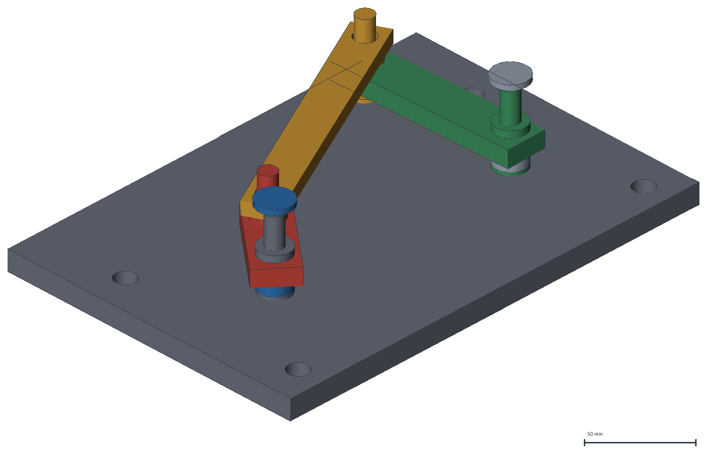
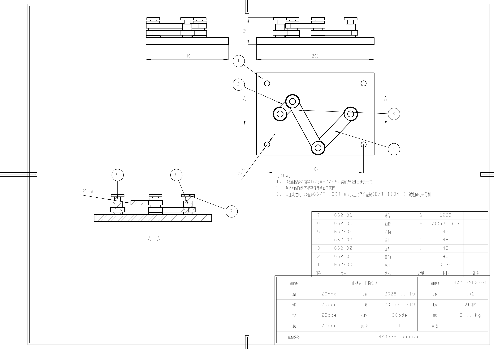
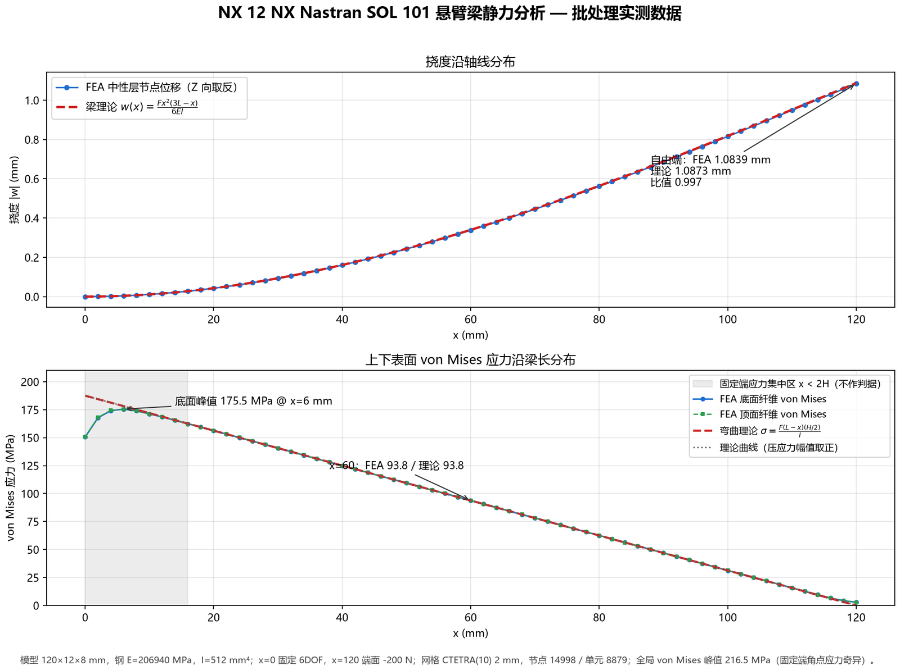
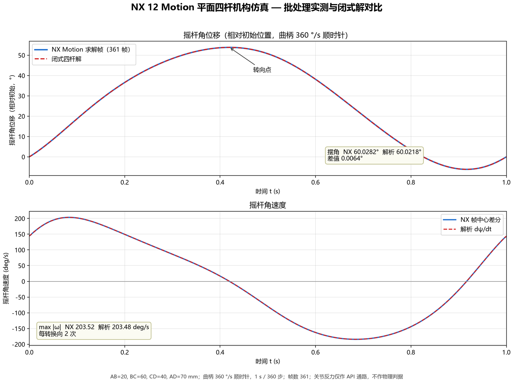
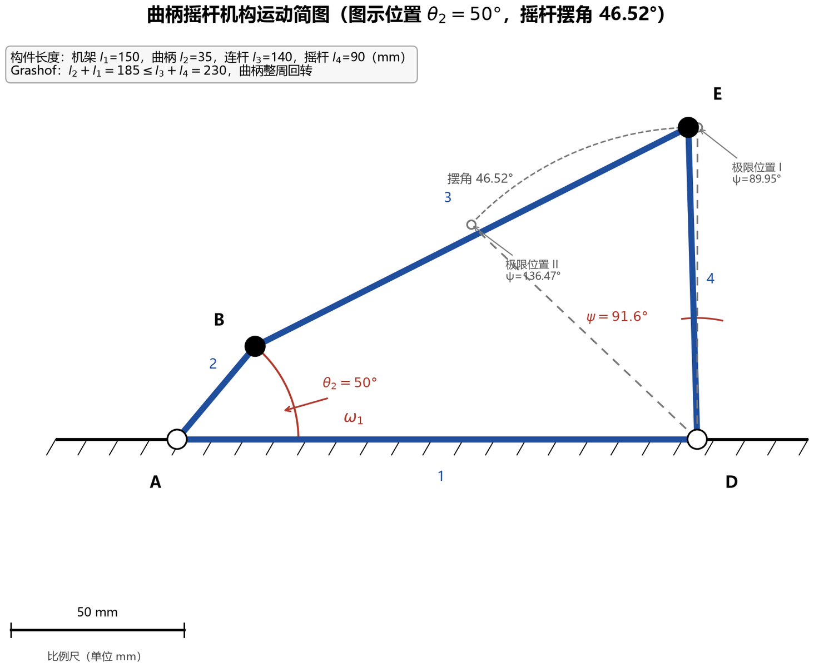
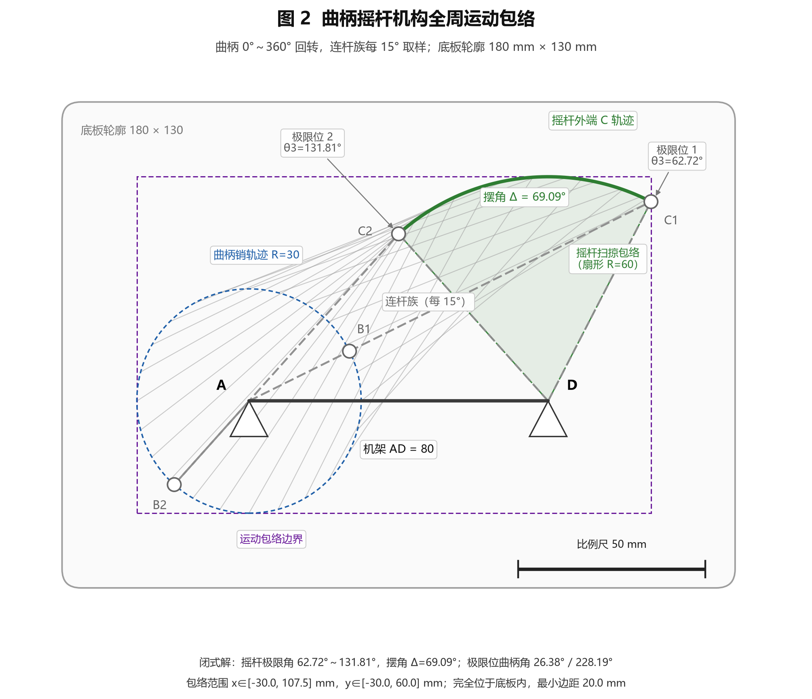
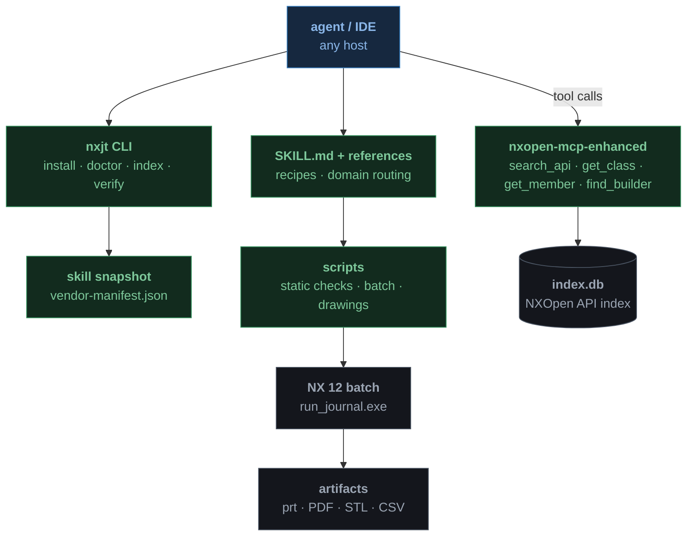

# nxopen-journal-toolkit

[中文](README.md) | English

An agent toolkit for NX 12: one skill plus one API-retrieval MCP, installed with one command.

`Windows 11` · `NX 12 (12.0.0.27)` · `Python 3.11+` · `Skill 1.7.1` · `v1.0.1` · `MIT`

## Contents

- [Background](#background)
- [Features](#features)
- [Architecture](#architecture)
- [Installation](#installation)
- [Behavior and limitations](#behavior-and-limitations)
- [Tests](#tests)
- [License](#license)

## Background

`nxopen-journal` covers how to write journals, run them in NX, and verify the output; `nxopen-mcp-enhanced` covers what the NXOpen .NET API actually looks like. The former gives the agent an executable method, the latter keeps it from guessing APIs from memory. Either works alone; together they form the complete toolkit.

With only the skill, an agent can still write `CreateExtrudeBuilder` as a nonexistent overload. With only the MCP, it knows the API but not the NX 12 batch boundaries. The toolkit puts the skill snapshot and the MCP on one install path, and `nxjt doctor` checks the skill, index, and MCP configuration together, avoiding a half-installed state where the skill works but the retrieval service never started. The component list is in [docs/VERSIONS.md](docs/VERSIONS.md); changes are in [CHANGELOG.md](CHANGELOG.md).

## Features

**One-command install**
`nxjt install` places the skill snapshot and writes the host MCP configuration or prints a ready-to-merge snippet; `nxjt index` builds the API index; `nxjt verify` runs the skill self-check and a real MCP smoke test. Both packages are installed from GitHub Releases with `pip`; neither is on PyPI.

**Skill: nxopen-journal**
Covers 3D modeling, assemblies, Drafting/GB drawings, FEA, motion simulation, and reverse reconstruction. Every domain follows the same loop: the agent writes a journal → batch execution → artifact verification. It ships a static checker `check_journal.py`, a test standard layer `nxlib/`, an offline rendering chain `render/`, and 51 gated NX regression cases. Coverage and boundaries are in the [skill README](https://github.com/EVOL233awa/nxopen-journal).

**MCP: nxopen-mcp-enhanced**
Four tools: `search_api` (hybrid semantic retrieval), `get_class` (members and inheritance chain, paged), `get_member` (exact signature and parameters), and `find_builder` (CAM operation → Builder skeleton). The enhanced fork adds OpenAI-compatible remote embedding, optional reranking, offline exact-name fallback, and `get_class` paging over upstream; details are in the [fork README](https://github.com/EVOL233awa/nxopen-mcp-enhanced).

**Self-check**
`nxjt doctor` checks `NX_HOME`, `run_journal.exe`, NXOpen XML, the index, the embedding backend, MCP configuration, and component versions; `nxjt verify` starts the real MCP and looks up a member rather than only checking `--help`.

**Example artifacts**
All nine images below are real outputs of this toolkit, not mockups: eight are from 1.0.0 and the GB assembly drawing is from skill 1.7.0. Generation environment: ZCode + DeepSeek-V4.1-Flash-1017 (max) + nxopen-journal-toolkit 1.0.0; NX 12.0.0.27, Windows 11, host Python 3.12.0, NX embedded Python 3.6.1. 3D images are rendered offline from STL outside NX; drawing images are converted from PDFs exported directly by NX Drafting; FEA/motion/mechanism images are plotted on the host from solver data or closed-form solutions.

| 3D modeling: bearing bracket (180×120×16, Ø64×70 boss, Ø36 through hole, two ribs, 4×Ø18 counterbores) | Assembly: crank-rocker assembly (7 types, 18 parts) |
|---|---|
|  |  |

The modeled part is a single solid with 40 faces: base plate, support column, horizontal boss, two triangular ribs, and counterbored holes. The assembly is a crank-rocker mechanism on a 200×140×12 base plate with AB=30, BC=90, CD=80, AD=120, and 18 component instances.

| Drafting: A3 part drawing (three views, 12 dimensions, Ø44/Ø20/2×Ø18) | GB assembly drawing: A3 (three views, A-A section, 7 balloons, 6 assembly dimensions, full title block) |
|---|---|
|  |  |

The left image is a 160×100×16 mounting plate with a Ø44×8 boss, a Ø20 through hole, 4×Ø9 corner holes, and 2×Ø18 counterbores; it is a single solid with 19 faces. The three views, dimension lanes, centerlines, and PDF are generated by `gb_drawing`; the PDF text layer was checked against 160/120/100/60/50/16/8/80/44/20/18/9. The right image is a first-angle A3 assembly drawing at 1:2, with balloons 1–7 matching the BOM, 6 assembly dimensions, and `audit_gb_assembly(strict=True)` passing.

| FEA: SOL 101 cantilever beam (200×20×20, 2.5 mm CTETRA(10), 40,199 nodes) |
|---|
|  |

Fixed end 6 DOF, free end −Z 500 N; free-end deflection FEA 0.4838 mm vs beam theory 0.4832 mm (ratio 1.0011), and the maximum deviation of surface von Mises from theory over x=25…190 is 0.533%; the root stress concentration is annotated separately and not used as a criterion.

| Motion simulation: planar four-bar (AB=30, BC=85, CD=50, AD=100, 721 frames) |
|---|
|  |

Crank −360 °/s, 1 s/720 steps; rocker swing angle NX 75.5113° vs closed-form 75.5091° (difference 0.0022°), peak angular velocity 239.363 vs 239.362 °/s, with two direction reversals per revolution. Joint reaction forces only validate the API path, not physics.

| Mechanism diagram: crank-rocker (30/90/60/80, θ=70°) | Motion envelope: full-cycle sweep (coupler family sampled every 15°) |
|---|---|
|  |  |

The diagram marks the two limit positions and a rocker swing angle of 69.09°; the envelope shows the crank-pin path (R=30), the point-C path, and the coupler family. The full-cycle envelope spans x=−30…107.5 and y=−30…60 mm, entirely inside the 180×130 base plate.

| Reverse reconstruction: face table → parameters → named expressions (16-face reference part) |
|---|
|  |

The reference part is 120×80×20 with a 60×40×8 rectangular pocket, a Ø20×12 through hole, and 4×Ø6×20 holes; all parameters are inferred from `face_table.csv` alone and rebuilt with 8 named expressions. Volume 166768.142 mm³ matches between the two parts, bounding-box difference 0, faces 16=16, hole groups 5=5, and G0–G9 pass (G7 is N/A because there are no fillets).

G0–G9 are the skill's ten hard gates for reverse-reconstructed parts; each returns one of PASS / FAIL / BLOCKED / N/A:

| Gate | Criterion |
|---|---|
| G0 single readable solid | one body, volume > 0, every face readable, STL export on both sides |
| G1 section profiles | at least one station per structure; per-station IoU ≥ 0.95, area difference ≤ 5%, no open loops |
| G2 holes and cones | every cylinder/cone group accounted for; radius ≤ 0.025 mm, axis position ≤ 0.05 mm, axis angle ≤ 0.1°, length ≤ 0.1 mm, half-angle ≤ 0.1° |
| G3 volume | relative difference ≤ 0.1% |
| G4 bounding box | position and size differences ≤ 0.05 mm each |
| G5 four views | top/front/side/iso outline IoU ≥ 0.99 |
| G6 two-way deviation | RMS ≤ 0.8 mm, P95 ≤ 1.8 mm |
| G7 fillet coverage | face and runway coverage ≥ 70% (0.10 mm), radius error ≤ 0.025 mm, local P95 ≤ 0.10 mm; N/A when the original has no fillets |
| G8 expression editability | every named expression ×1.1 changes the volume; liveness 1.0, no missing parameters |
| G9 feature-tree structure | features ≤ 4×structures+12, single-type share ≤ 0.50, tree depth ≤ 8 |

## Architecture



Install layout:

```text
nxopen-journal-toolkit/
├── src/nxopen_journal_toolkit/
│   ├── cli.py                    nxjt command implementation
│   └── _skill/
│       ├── nxopen_journal/       read-only skill snapshot (synced at release)
│       └── vendor-manifest.json  skill version, commit, per-file SHA-256
├── tools/sync_skill.py           exports and verifies the skill snapshot
├── docs/
│   ├── INSTALL.md                installation and embedding backend details
│   ├── INSTALL.en.md             English installation guide
│   ├── VERSIONS.md               component BOM and update rules
│   └── images/                   example artifact images
└── tests/                        CLI and install-chain tests
```

The skill snapshot is not a hand-written copy: `tools/sync_skill.py --ref <commit>` exports it from the skill repository with `git archive` and writes the manifest, while `--check` compares every file by SHA-256. When updating the skill, change the skill repository first, then sync the snapshot, so the two copies cannot drift.

## Installation

Quick start: copy the whole block below to an agent on any host. It checks the environment, installs the toolkit, places the skill in its own skill directory, registers the MCP, chooses an embedding backend, builds the index, and runs the self-check. When it finishes, the skill and MCP are directly usable in the host. Changes are in [CHANGELOG.md](CHANGELOG.md).

```text
Task: install and verify nxopen-journal-toolkit (the nxopen-journal skill + nxopen-mcp-enhanced MCP)
on this machine. When done, the skill and MCP must be directly usable in the host.

Repositories:
- Skill: https://github.com/EVOL233awa/nxopen-journal
- MCP: https://github.com/EVOL233awa/nxopen-mcp-enhanced
- Toolkit: https://github.com/EVOL233awa/nxopen-journal-toolkit

Host: follow your own skill directory and MCP configuration format. Do not assume a specific agent host.

Prerequisites (stop and report if any is missing; do not skip):
- Windows 11.
- Siemens NX 12; NX_HOME points to the install root (default D:\UG-NX12), and
  %NX_HOME%\NXBIN\run_journal.exe exists.
- Host Python 3.11+ (python -V). NX journals run on NX embedded Python 3.6.1, independent of host Python.

Steps:
1. Install the toolkit (not on PyPI; install from GitHub Releases, MCP first):
   python -m pip install https://github.com/EVOL233awa/nxopen-mcp-enhanced/releases/download/v1.0.1/nxopen_mcp_enhanced-1.0.1-py3-none-any.whl
   python -m pip install https://github.com/EVOL233awa/nxopen-journal-toolkit/releases/download/v1.0.1/nxopen_journal_toolkit-1.0.1-py3-none-any.whl
   Optional: python -m pip install pythonnet (show inherited members in get_class).
2. Place the skill:
   - The snapshot lives under the installed package's _skill/nxopen_journal; get its absolute path:
     python -c "import nxopen_journal_toolkit, pathlib; print(pathlib.Path(nxopen_journal_toolkit.__file__).parent / '_skill' / 'nxopen_journal')"
   - Copy or link it to <your skill directory>/nxopen-journal, keeping the directory name.
   - If your host follows a directory convention supported by nxjt, nxjt install --target <host> can
     place it automatically (see nxjt install --help for supported values).
   - Back up an existing target or use a link instead; do not use --force to delete a git repository.
3. Register the MCP (stdio):
   - Command: nxopen-mcp-enhanced serve --db <index path>;
     default index C:\Users\<you>\.nxopen-mcp-enhanced\index.db.
   - Register it in your host's MCP configuration format. Generic JSON:
     {"mcpServers":{"nxopen":{"command":"nxopen-mcp-enhanced","args":["serve","--db","<index path>"]}}}
   - If nxjt supports your host, nxjt install --target <host> writes the configuration or prints a
     ready-to-merge snippet; otherwise write the JSON above according to your host's documentation.
4. Choose an embedding backend and build the index:
   - Remote (recommended, no model download): requires an OpenAI-compatible service. Put the
     following variables in the MCP configuration env, and set the same values in the shell that
     builds the index:
     NXOPEN_MCP_EMBEDDER=remote
     NXOPEN_MCP_EMBED_URL=https://api.siliconflow.cn
     NXOPEN_MCP_EMBED_MODEL=BAAI/bge-m3
     NXOPEN_MCP_EMBED_API_KEY=<ask the user; do not echo or write to logs>
     NXOPEN_MCP_RERANK=1
     NXOPEN_MCP_RERANK_URL=https://api.siliconflow.cn/v1/rerank
     NXOPEN_MCP_RERANK_MODEL=BAAI/bge-reranker-v2-m3
     NXOPEN_MCP_RERANK_API_KEY=<same API key>
   - Local (offline): python -m pip install FlagEmbedding; the first run downloads about 2 GB.
   - Build: nxjt index --workers <cores> (uses NX_HOME by default, D:\UG-NX12 if unset).
     To reuse an existing upstream index: nxjt index --db C:\Users\<you>\.nxopen-mcp\index.db
     (the embedding model must match, otherwise rebuild). A full index may take hours: run it in the
     background, report progress periodically, and do not interrupt it.
5. Self-check:
   - nxjt doctor: checks NX_HOME, run_journal.exe, NXOpen XML, the index, the embedding backend, and
     the MCP executable. The MCP configuration check targets the toolkit's default write target; if
     your host does not use that target, the item will fail as expected—verify your own MCP
     configuration instead.
   - nxjt verify --skill-dir <your skill directory>: skill self-check + a real MCP stdio smoke test
     (get_member "Tag"). Pass --skill-dir when the skill directory is outside the CLI's probe paths;
     the smoke test reads the index path from the toolkit's default MCP configuration, so if the
     index is elsewhere, rely on the get_member call from step 3.
   - Call get_member (argument "Tag") from your host's MCP client and confirm it returns a member;
     then call search_api (query "create extrude builder") and confirm semantic search works.
6. Report:
   - Install paths, toolkit and skill versions, index path and size, MCP registration location,
     doctor/verify results, and both MCP self-check results.
   - For failures, include the last 50 lines of raw output; do not report only the exit code; do not
     claim unverified steps passed; do not echo the API key.
```

You can also install manually with the steps below.

### Prerequisites

| Item | Requirement |
|---|---|
| OS | Windows 11 (NX 12 batch execution and MinGW/Git Bash paths verified) |
| NX | Siemens NX 12 (verified 12.0.0.27) with the NXOpen automation interface |
| `NX_HOME` | Points to the NX install root; default `D:\UG-NX12` |
| Python | Host 3.11+ (`nxjt` and the MCP); NX journals run on NX embedded Python 3.6.1 |
| Disk | Skill about 4 MB; index about 0.4 GB; local embedding adds about 2 GB of models |

### Install from a release

Neither this repository nor `nxopen-mcp-enhanced` is on PyPI; both wheels are attached to GitHub Releases. The MCP is a dependency of the toolkit; install the MCP first so that `pip` satisfies the dependency locally:

```bash
python -m pip install https://github.com/EVOL233awa/nxopen-mcp-enhanced/releases/download/v1.0.1/nxopen_mcp_enhanced-1.0.1-py3-none-any.whl
python -m pip install https://github.com/EVOL233awa/nxopen-journal-toolkit/releases/download/v1.0.1/nxopen_journal_toolkit-1.0.1-py3-none-any.whl
```

For development or extras, install from source (editable), again MCP first:

```bash
git clone https://github.com/EVOL233awa/nxopen-mcp-enhanced
python -m pip install -e "nxopen-mcp-enhanced[reflect]"
git clone https://github.com/EVOL233awa/nxopen-journal-toolkit
cd nxopen-journal-toolkit
python -m pip install -e .
```

### Place the skill and register the MCP

`nxjt install` places the skill according to the host. MCP configuration is written or printed as follows:

| `--target` | Skill directory | MCP configuration |
|---|---|---|
| `codex` | `%USERPROFILE%\.codex\skills` | Prints a Codex `config.toml` snippet |
| `claude` | `%USERPROFILE%\.claude\skills` | Prints a Claude `.mcp.json` snippet |
| `all` | All built-in host directories | Writes the default MCP configuration entry and prints the other snippets |
| `auto` (default) | Detects existing built-in host directories; falls back to the default target | Same as the detection result |

Other target names and directories are listed by `nxjt install --help`; hosts not in the table are handled manually.

```bash
nxjt install                       # auto
nxjt install --target codex        # or claude / all, etc.
nxjt install --skill-only          # leave MCP configuration untouched
```

`nxjt install` backs up the MCP configuration before writing and skips it when unchanged; an existing skill directory is skipped by default, `--force` overwrites it, but a git repository is never deleted.

For hosts not in the table (other agents, custom clients): copy or link the bundled skill snapshot into your own skill directory, keeping the name `nxopen-journal`; register the MCP in the host's stdio server format. Generic JSON:

```json
{"mcpServers":{"nxopen":{"command":"nxopen-mcp-enhanced","args":["serve","--db","<index path>"]}}}
```

The default index path is `%USERPROFILE%\.nxopen-mcp-enhanced\index.db`, matching `nxjt index --db`.

### Choose an embedding backend

The toolkit's default dependencies do not force a local model; choose one path before building the index:

```bash
# Remote: SiliconFlow free models (BAAI/bge-m3 + BAAI/bge-reranker-v2-m3, no model download)
nxjt config embed --provider remote

# Or local BGE-M3 (offline; first use downloads about 2 GB)
pip install FlagEmbedding
```

The remote path does not install `FlagEmbedding`; the free tier has fixed rate limits and requires identity verification, and same-named models with a `Pro/` prefix are billed. `nxjt config embed --provider remote` also enables reranking (Recall@5 57.53% → 69.86% on 73 golden queries).

`nxjt config embed` interactively writes the base URL, embedding model, API key, rerank URL, and model for `nxjt index`; it writes the toolkit's default MCP configuration entry. If your host does not use that entry, use `NXOPEN_MCP_*` environment variables instead: set them in the shell before building the index and put the same variables in the host MCP configuration's `env`. Switch back to local with `--provider local`. When the same embedding model is deployed locally and remotely, an existing index does not need a rebuild.

| Setting | Description | Default |
|---|---|---|
| `NX_HOME` | NX install root | `D:\UG-NX12` |
| `NXOPEN_MCP_EMBEDDER` | `remote` / `openai` for an OpenAI-compatible service; `ollama` for Ollama; unset for local BGE-M3 | unset (local) |
| `NXOPEN_MCP_EMBED_URL` | Remote embedding base URL | `http://127.0.0.1:11436` |
| `NXOPEN_MCP_EMBED_MODEL` | Remote embedding model name | `bge-m3` |
| `NXOPEN_MCP_EMBED_API_KEY` | Remote embedding bearer token | empty |
| `NXOPEN_MCP_RERANK` | Set to `1` / `true` / `on` to enable reranking | off |
| `NXOPEN_MCP_RERANK_URL` | Reranking endpoint | `http://127.0.0.1:8000/v1/rerank` |
| `NXOPEN_MCP_RERANK_MODEL` | Reranking model name | empty |
| `NXOPEN_MCP_RERANK_API_KEY` | Reranking bearer token | empty |

Without FlagEmbedding and without a configured remote service, `nxjt index` fails and `nxjt doctor` reports a warning. `pythonnet` only affects whether `get_class` shows inherited members; install it as needed.

### Build the index

```bash
nxjt index                  # uses NX_HOME (default D:\UG-NX12)
nxjt index --nx-path "C:\Siemens\NX12.0" --workers 4
```

The index is a vector store of the NXOpen XML documentation, written to the same path as `--db` in the MCP configuration. A full NX 12 documentation set has about 100,000 members; local BGE-M3 embedding on an 8-core laptop CPU can take hours, so run it overnight; `--workers` submits batches in parallel. An existing upstream `nxopen-mcp` index can be reused when the embedding model matches:

```bash
nxjt index --db C:\Users\<you>\.nxopen-mcp\index.db
```

### Self-check

```bash
nxjt doctor     # NX_HOME, run_journal.exe, managed XML, index, MCP configuration, component versions
nxjt verify     # check_repo.py + a real MCP stdio smoke test (starts the server and calls get_member)
nxjt verify --nx  # adds the NX regression suite (54 case files, 51 gated, slow)
```

`verify` exits nonzero if any check fails; the smoke test starts the configured MCP with `--db` and asks for a member. When the skill directory is outside the CLI's probe paths `%USERPROFILE%\.codex\skills` and `%USERPROFILE%\.claude\skills`, pass `--skill-dir <skill directory>` to `verify`. `doctor`'s MCP configuration check targets the toolkit's default write target; if the host does not use that target, the item fails as expected—verify the host's own MCP configuration and a real `get_member` call instead.

### Commands

| Command | Purpose |
|---|---|
| `nxjt install [--target <host>] [--force] [--skill-only]` | Copies the skill; for supported hosts writes or prints MCP configuration snippets (backup, idempotent, refuses to delete git repos) |
| `nxjt doctor` | Checks NX, `run_journal.exe`, `NXBIN\managed` XML, the index, MCP configuration, and BOM versions |
| `nxjt index [--nx-path ...] [--db ...] [--workers N]` | Builds/incrementally writes the index with the bundled MCP, reusing the configured embedding environment |
| `nxjt verify [--nx] [--skill-dir ...]` | Skill repository self-check + MCP stdio smoke; `--nx` runs the NX regression suite |
| `nxjt config embed --provider local\|remote` | Switches between local BGE-M3 and OpenAI-compatible remote embedding/reranking |

## Behavior and limitations

- When `nxjt install` writes MCP configuration: it backs up first, skips when unchanged, and skips an existing skill directory by default.
- When the target is a git repository: `--force` refuses to delete it; use a link or a manual backup instead.
- When the host is not in the built-in directory table: place the skill snapshot manually and register the MCP in the host's stdio format.
- When remote embedding is unreachable: whole names and CamelCase tokens fall back to local exact matches; when reranking is unreachable, queries wait 15 s for the timeout and then use the unranked order.
- When the index is not at the default path: `doctor`/`verify` checks fail as expected; rely on the host's own MCP configuration and a real `get_member` call.
- Only NX 12 is verified. NX 2506 differs in threading APIs, expression `.Value`, multi-body mass, and Block boolean behavior; the skill recipes are pinned to NX 12.
- The index is not prebuilt: the package ships neither an index nor NX documentation; without an index, none of the four tools work.
- Not on PyPI: install from GitHub Releases; for source installs see [Installation](#installation).
- Domain limitations (batch mode cannot take screenshots, reverse reconstruction does not guarantee complex parts, FEA/Motion require the appropriate licenses, array type boundaries) are documented in the [skill README](https://github.com/EVOL233awa/nxopen-journal/blob/main/README.en.md#behavior-and-limitations).

## Tests

```bash
python -m pytest -q                 # CLI / install-chain tests
python tools/sync_skill.py --check  # skill snapshot matches the manifest
python -m build                     # build wheel / sdist
nxjt verify                         # post-install self-check + MCP smoke
```

When changing the skill, commit in the skill repository, then run `python tools/sync_skill.py --ref <commit>`; do not edit the `_skill/` snapshot as source (the manifest will reject it). After changing the CLI, run at least `pytest` and a real `nxjt verify`.

## License

- Skill: `nxopen-journal` (MIT), upstream repository <https://github.com/EVOL233awa/nxopen-journal>.
- MCP: `nxopen-mcp-enhanced` (MIT), forked from <https://github.com/mingfeng6684/nxopen-mcp>, enhanced repository <https://github.com/EVOL233awa/nxopen-mcp-enhanced>.
- This toolkit: MIT. Full license text in [LICENSE](LICENSE) and [LICENSES/](LICENSES/); attribution in [NOTICE](NOTICE).
- NX, NXOpen, and NX Nastran are trademarks of Siemens; this repository does not distribute Siemens documentation, binaries, or indexes.
