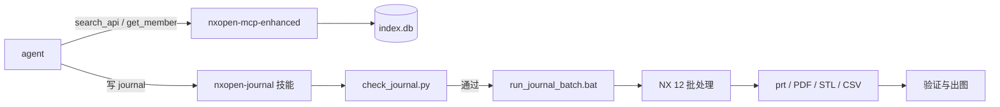
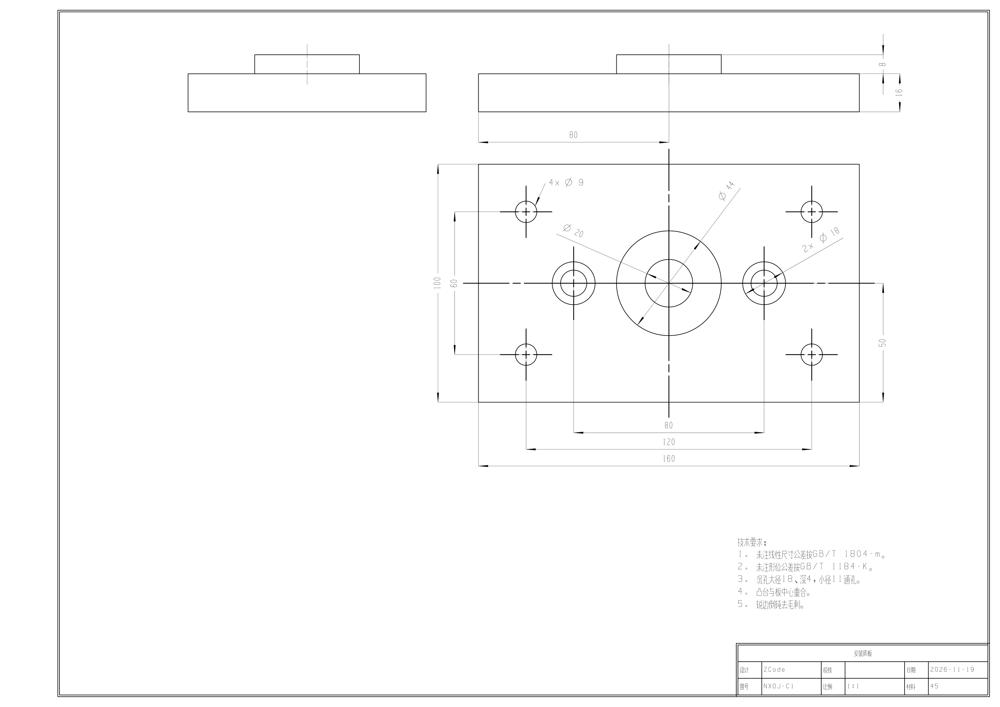
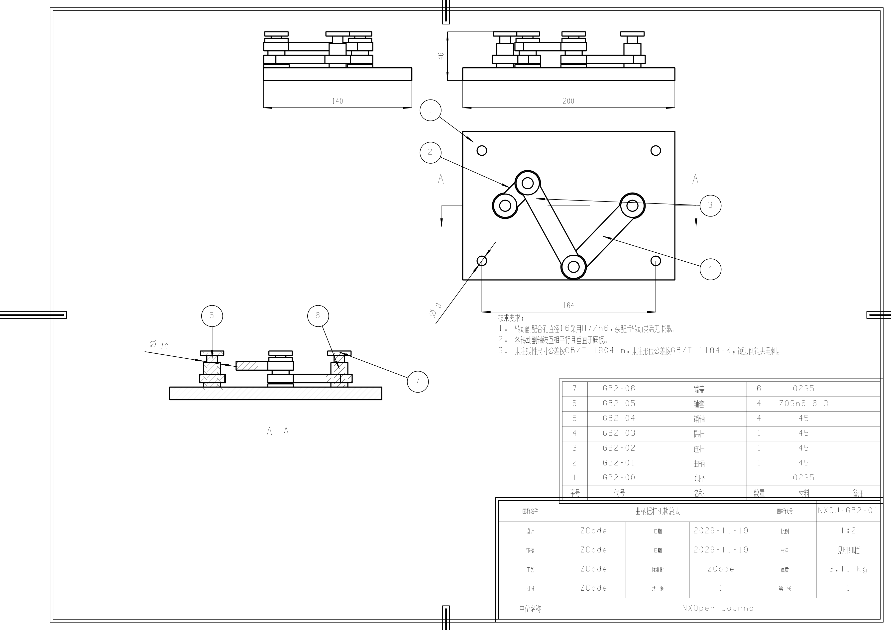
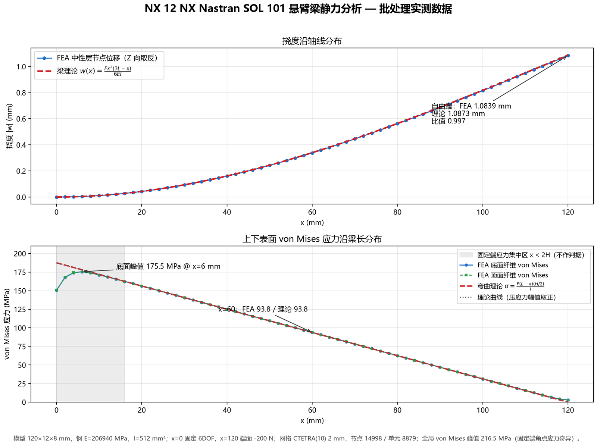
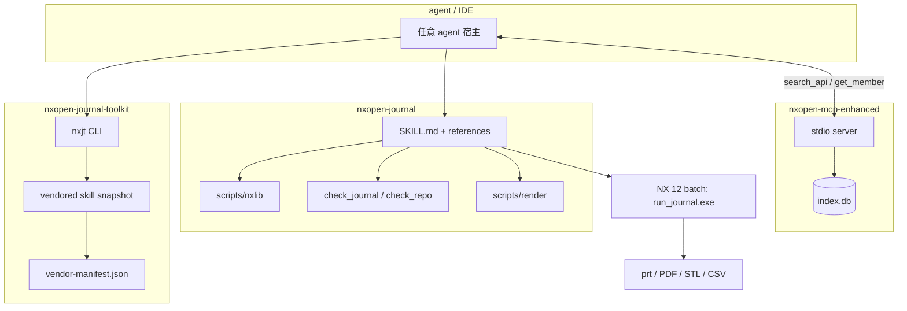

# nxopen-journal-toolkit

[English](README.en.md) | 中文

面向 Siemens NX 12 的 agent 工具包：**一个技能 + 一个 MCP 检索服务**，一条命令完成安装。

`nxopen-journal` 负责“怎么写 journal、怎么在 NX 里跑、产物怎么验”；`nxopen-mcp-enhanced` 负责
“NXOpen .NET API 到底长什么样”。前者让 agent 有可执行的方法，后者让 agent 不靠记忆猜 API。
两者独立可用，合起来才是本工具包的完整形态。

当前版本 **1.0.0**（组件清单见 [docs/VERSIONS.md](docs/VERSIONS.md)）。

## 目录

- [两个组成部分](#两个组成部分)
- [安装](#安装)
- [命令](#命令)
- [agent 工作流](#agent-工作流)
- [示例产物](#示例产物)
- [架构](#架构)
- [版本与兼容性](#版本与兼容性)
- [已知限制](#已知限制)
- [来源与许可](#来源与许可)
- [开发](#开发)

## 两个组成部分

| 组件 | 作用 | 形态 | 单独安装 |
|---|---|---|---|
| [`nxopen-journal`](https://github.com/EVOL233awa/nxopen-journal) | NX 12 journal 技能：建模、装配、Drafting、FEA、Motion、逆向重建，以及静态检查与回归套件 | 技能目录（`SKILL.md` + `references/` + `scripts/`） | 复制技能目录即可 |
| [`nxopen-mcp-enhanced`](https://github.com/EVOL233awa/nxopen-mcp-enhanced) | NXOpen .NET API 检索 MCP：类/成员/签名/Builder 配方，支持本地或远程嵌入与重排 | MCP stdio server（`nxopen-mcp-enhanced serve`） | `pip install nxopen-mcp-enhanced`（发布后） |

### 技能：nxopen-journal

覆盖六个域：三维建模、装配、Drafting/国标出图、有限元、运动仿真、逆向重建。工作方式统一为
“agent 写 journal → 批处理执行 → 核对产物”，并带静态检查 `scripts/check_journal.py`、15 个模块的
用例标准层 `scripts/nxlib/`、离线出图链 `scripts/render/` 与 51 个带判定的 NX 回归用例。
各域的覆盖范围与已知边界见[技能 README](https://github.com/EVOL233awa/nxopen-journal)。

### MCP：nxopen-mcp-enhanced

四个工具：`search_api`（混合语义检索）、`get_class`（成员与继承链，分页）、`get_member`（精确
签名与参数）、`find_builder`（CAM 工序 → Builder 骨架）。本工具包使用增强 fork，相对上游增加了
OpenAI 兼容远程嵌入、可选重排、精确名离线回退与 `get_class` 分页；细节见
[fork README](https://github.com/EVOL233awa/nxopen-mcp-enhanced)。

### 为什么建议一起装

技能文档给的是“做法”，MCP 给的是“事实”。只装技能时，agent 仍可能把 `CreateExtrudeBuilder`
写成不存在的重载；只装 MCP 时，agent 知道 API 但不知道 NX 12 的批处理边界（例如哪些 builder
在 NX 12 上静默失效）。工具包把两者放进同一条安装链路，`nxjt doctor` 会同时检查技能、索引与
MCP 配置，避免“技能能跑但检索服务没起来”的半安装状态。

## 安装

### 交给 agent 安装（推荐）

把下面整段复制给任意宿主的 agent。它负责检查环境、安装工具包、把技能放进自己的技能目录、注册
MCP、选择嵌入后端、建索引并自检；跑完后技能与 MCP 在宿主里可直接使用。

```text
任务：在本机安装并验证 nxopen-journal-toolkit（nxopen-journal 技能 + nxopen-mcp-enhanced MCP），
结束后技能与 MCP 在宿主里可直接使用。

仓库：
- 技能：https://github.com/EVOL233awa/nxopen-journal
- MCP：https://github.com/EVOL233awa/nxopen-mcp-enhanced
- 工具包：https://github.com/EVOL233awa/nxopen-journal-toolkit

宿主：按你自己的技能目录与 MCP 配置格式操作，不要假定宿主是某个特定 agent。

环境前提（缺一即停并报告，不要跳过）：
- Windows 11。
- Siemens NX 12；NX_HOME 指向安装根（默认 D:\UG-NX12），%NX_HOME%\NXBIN\run_journal.exe 存在。
- 宿主 Python 3.11+（python -V）。NX journal 由 NX 内嵌 Python 3.6.1 执行，与宿主 Python 无关。

步骤：
1. 安装工具包（两者都未发布到 PyPI，必须从源码安装；先装 MCP，再装工具包）：
   git clone https://github.com/EVOL233awa/nxopen-mcp-enhanced
   python -m pip install -e nxopen-mcp-enhanced
   git clone https://github.com/EVOL233awa/nxopen-journal-toolkit
   cd nxopen-journal-toolkit
   python -m pip install -e .
2. 放置技能：
   - 把 src/nxopen_journal_toolkit/_skill/nxopen_journal 复制或链接为
     <你的技能目录>/nxopen-journal，目录名保持 nxopen-journal。
   - 若宿主属于 nxjt 支持的目录约定，也可用 nxjt install --target <宿主> 自动放置
     （支持的取值见 nxjt install --help）。
   - 目标已存在先备份或改用链接；不要用 --force 删除 git 仓库。
3. 注册 MCP（stdio）：
   - 命令：nxopen-mcp-enhanced serve --db <索引路径>；
     默认索引 C:\Users\<you>\.nxopen-mcp-enhanced\index.db。
   - 按宿主的 MCP 配置格式注册，通用 JSON：
     {"mcpServers":{"nxopen":{"command":"nxopen-mcp-enhanced","args":["serve","--db","<索引路径>"]}}}
   - 若宿主受 nxjt 支持，nxjt install --target <宿主> 会写入配置或打印可直接合入的片段；
     否则按宿主文档手写上述 JSON。
4. 选择嵌入后端并建索引：
   - 远程（推荐，不下载模型）：需要 OpenAI 兼容服务。把以下变量写入 MCP 配置的 env，
     并在建索引的 shell 里设为同样的值：
     NXOPEN_MCP_EMBEDDER=remote
     NXOPEN_MCP_EMBED_URL=https://api.siliconflow.cn
     NXOPEN_MCP_EMBED_MODEL=BAAI/bge-m3
     NXOPEN_MCP_EMBED_API_KEY=<向用户索取；不要回显或写入日志>
     NXOPEN_MCP_RERANK=1
     NXOPEN_MCP_RERANK_URL=https://api.siliconflow.cn/v1/rerank
     NXOPEN_MCP_RERANK_MODEL=BAAI/bge-reranker-v2-m3
     NXOPEN_MCP_RERANK_API_KEY=<同 API key>
   - 本地（离线）：python -m pip install "nxopen-mcp-enhanced[embed]"，首次下载约 2 GB。
   - 建索引：nxjt index --workers <核数>（默认使用 NX_HOME，缺省 D:\UG-NX12）；
     已有上游索引可复用：nxjt index --db C:\Users\<you>\.nxopen-mcp\index.db
     （嵌入模型必须一致，否则重建）。全量索引可能数小时：后台运行并定期报告进度，不要中断。
5. 自检：
   - nxjt doctor：检查 NX_HOME、run_journal.exe、NXOpen XML、索引、嵌入后端、MCP 可执行。
     其中 MCP 配置检查针对工具包默认的写入目标；你的宿主不使用该目标时该项会失败，属预期，
     改为核对你自己的 MCP 配置。
   - nxjt verify --skill-dir <你的技能目录>：技能自检 + 真实 MCP stdio 冒烟
     （get_member "Tag"）。技能目录不在 CLI 探测范围时必须传 --skill-dir；冒烟读取的索引
     路径来自工具包默认的 MCP 配置，索引不在默认路径时以第 3 条的 get_member 调用为准。
   - 在宿主的 MCP 客户端里实际调用 get_member（参数 "Tag"），确认返回成员。
6. 报告：
   - 安装路径、工具包与技能版本、索引路径与大小、MCP 注册位置、doctor/verify 结果。
   - 失败项附原始输出末尾 50 行；不要只报退出码；不要声称未验证的步骤已通过；不要回显 API key。
```

### 前置

| 项 | 要求 |
|---|---|
| 操作系统 | Windows 11（NX 12 批处理与 MinGW/Git Bash 路径已验证） |
| NX | Siemens NX 12（当前验证版本 12.0.0.27）及 NXOpen 自动化接口 |
| `NX_HOME` | 指向 NX 安装根，默认 `D:\UG-NX12` |
| Python | 宿主 3.11+（`nxjt` 与 MCP）；NX journal 由 NX 内嵌 Python 3.6.1 执行 |
| 磁盘 | 技能约 4 MB；索引约 0.4 GB；只有走本地嵌入路线才另需约 2 GB 模型 |

### 从源码安装（当前状态）

本仓库与 `nxopen-mcp-enhanced` 都尚未发布到 PyPI，必须从源码安装。MCP 是工具包的依赖，
先装 MCP 再装工具包，`pip` 才能在本机满足依赖，不会去 PyPI 找同名包：

```bash
git clone https://github.com/EVOL233awa/nxopen-mcp-enhanced
python -m pip install -e nxopen-mcp-enhanced
git clone https://github.com/EVOL233awa/nxopen-journal-toolkit
cd nxopen-journal-toolkit
python -m pip install -e .
```

### 安装技能与 MCP

`nxjt install` 按宿主放置技能，MCP 配置的写入或打印范围如下：

| `--target` | 技能目录 | MCP 配置 |
|---|---|---|
| `codex` | `%USERPROFILE%\.codex\skills` | 打印 Codex `config.toml` 片段 |
| `claude` | `%USERPROFILE%\.claude\skills` | 打印 Claude `.mcp.json` 片段 |
| `all` | 所有内置宿主目录 | 写入默认 MCP 配置入口，并打印其余片段 |
| `auto`（默认） | 探测已存在的内置宿主目录，未探测到回退默认目标 | 同探测结果 |

其余目标名与目录以 `nxjt install --help` 为准；表中未列出的宿主按下一段手动放置。

```bash
nxjt install                       # auto
nxjt install --target codex        # 换 claude / all 等
nxjt install --skill-only          # 不碰 MCP 配置
```

`nxjt install` 写 MCP 配置前自动备份，内容不变时跳过；技能目录已存在时默认跳过，`--force`
覆盖，但目标是 git 仓库时拒绝删除。目录约定与写入目标以 `--target` 表为准；宿主不在表内时
按下一段手动放置。

宿主不在上表时（其他 agent、自建客户端）：把内置技能快照复制或链接到自己的技能目录，目录名保持
`nxopen-journal`；MCP 按宿主的 stdio server 格式注册，通用 JSON：

```json
{"mcpServers":{"nxopen":{"command":"nxopen-mcp-enhanced","args":["serve","--db","<索引路径>"]}}}
```

索引路径默认 `%USERPROFILE%\.nxopen-mcp-enhanced\index.db`，与 `nxjt index --db` 保持一致。

### 选择嵌入后端

工具包默认依赖不强制安装本地模型，建索引前先选一条：

```bash
# 远程：硅基流动免费模型（BAAI/bge-m3 + BAAI/bge-reranker-v2-m3，不下载模型）
nxjt config embed --provider remote

# 或本地 BGE-M3（离线路线；首次使用下载约 2 GB）
pip install "nxopen-mcp-enhanced[embed]"
```

远程路线不装 `[embed]`；免费档有固定 Rate Limits、需实名认证，`Pro/` 前缀同名模型收费。
`nxjt config embed --provider remote` 会同时打开重排（Recall@5 57.53% → 69.86%，73 条 golden）。

`nxjt config embed` 交互写入 base URL、嵌入模型、API key、rerank URL 与模型，供 `nxjt index`
沿用；它写入的是工具包默认的 MCP 配置入口。宿主不使用该入口时改用 `NXOPEN_MCP_*` 环境变量：
建索引前在 shell 里设置，并把同一组变量写入宿主 MCP 配置的 `env`（完整清单见上方 agent 安装
提示词）。切回本地用 `--provider local`。已建索引无需重建（本地与云端同权重向量的余弦
0.99988–0.99994）。远程模式查询依赖网络：嵌入不可达时，整串名与查询中的驼峰标识符退回本地
精确匹配；重排不可达时等 15 s 超时后回退到未重排顺序。

未安装 FlagEmbedding 且未配置远程服务时，`nxjt index` 会失败，`nxjt doctor` 会给出 warn。
`[reflect]`（pythonnet）只影响 `get_class` 是否显示继承成员，按需安装。

### 建索引

```bash
nxjt index                  # 使用 NX_HOME（默认 D:\UG-NX12）
nxjt index --nx-path "C:\Siemens\NX12.0" --workers 4
```

索引是 NXOpen XML 文档的向量库，写入 MCP 配置中 `--db` 指向的同一路径。全量 NX 12 文档约
10 万成员，8 核笔记本 CPU 上本地 BGE-M3 嵌入可能需要数小时，建议过夜跑；机器内存通道越多、
`--workers` 收益越明显。已有上游 `nxopen-mcp` 索引时可直接复用：

```bash
nxjt index --db C:\Users\<you>\.nxopen-mcp\index.db
```

### 自检

```bash
nxjt doctor     # NX_HOME、run_journal.exe、managed XML、索引、MCP 配置、组件版本
nxjt verify     # check_repo.py + 真实 MCP stdio 冒烟（启动 server 调 get_member）
nxjt verify --nx  # 追加 NX 回归套件（51 个带判定的用例，耗时长）
```

`verify` 任一项失败即非零退出；冒烟会用配置里的 `--db` 真正启动 MCP 并查一个成员，不是只看
`--help`。技能目录不在 CLI 探测的 `%USERPROFILE%\.codex\skills`、`%USERPROFILE%\.claude\skills`
时，`verify` 需传 `--skill-dir <技能目录>`。`doctor` 的 MCP 配置检查针对工具包默认的写入目标；
宿主不使用该目标时该项会失败，属预期，以宿主自身的 MCP 配置和 `get_member` 实际调用为准。
`verify` 冒烟读取的索引路径同样来自工具包默认的 MCP 配置，索引不在默认路径时以宿主调用为准。

## 命令

| 命令 | 作用 |
|---|---|
| `nxjt install [--target <宿主>] [--force] [--skill-only]` | 复制技能；内置支持的宿主写入或打印 MCP 配置片段（备份、幂等、拒绝删 git 仓库） |
| `nxjt doctor` | 检查 NX、`run_journal.exe`、`NXBIN\managed` XML、索引、MCP 配置、BOM 版本 |
| `nxjt index [--nx-path ...] [--db ...] [--workers N]` | 用内置 MCP 构建/增量写入索引，沿用配置里的嵌入环境 |
| `nxjt verify [--nx] [--skill-dir ...]` | 技能仓库自检 + MCP stdio 冒烟；`--nx` 跑 NX 回归套件 |
| `nxjt config embed --provider local\|remote` | 切换本地 BGE-M3 与 OpenAI 兼容远程嵌入/重排 |

## agent 工作流

安装完成后，agent 的典型链路：



一个具体例子：

1. 用户说“建一个 160×100 的轴承支座，带凸台、筋板和沉头孔，再出一张 A3 零件图”。
2. agent 用 `search_api("create extrude builder")` 找到 `ExtrudeBuilder`，用 `get_member`
   核对 `Limits.StartExtend.Value` 与 NX 版本。
3. agent 读技能的 `references/modeling.md`，按草图—拉伸—布尔—孔的顺序写 journal。
4. `python scripts/check_journal.py job.py` 按 NX 内嵌 Python 3.6 语法与坑位规则做静态检查。
5. `scripts/run_journal_batch.bat job.py workdir` 在 NX 12 中批处理执行。
6. 产物用 `scripts/render/` 导出 STL/PDF 图，用 `nxlib.measure` 与交付件门核对体积、包盒、面表。

## 示例产物

以下九张图都是本工具包的实际产物，不是示意图：八张来自 1.0.0，国标装配图来自技能 1.7.0。生成环境：

即 ZCode + DeepSeek-V4.1-Flash-1017（max）+ nxopen-journal-toolkit 1.0.0；NX 12.0.0.27，
Windows 11，宿主 Python 3.12.0，NX 内嵌 Python 3.6.1。三维图由 STL 在 NX 外离线渲染，
工程图为 NX Drafting 直接导出的 PDF 转图，有限元/运动/机构图为求解数据或闭式解在宿主绘制。

| 三维建模：轴承支座（180×120×16，Ø64×70 凸台、Ø36 通孔、双筋、4×Ø18 沉孔） | 装配：曲柄摇杆总成（7 类 18 件） |
|---|---|
|  |  |

建模件由底板、支撑柱、水平凸台、两条三角筋与孔包沉头孔组成，单实体 40 面；图由导出的 STL
渲染，带 50 mm 比例尺。装配件为底板 200×140×12，杆长 AB=30、BC=90、CD=80、AD=120 的曲柄
摇杆机构，含 4 根销轴、4 个轴套与 6 个端盖，共 18 个组件实例。

| Drafting：A3 零件图（三视图、12 条尺寸、Ø44/Ø20/2×Ø18） | 国标装配图：A3（三视图、A-A 剖视、7 个序号球、6 条装配尺寸、完整标题栏） |
|---|---|
|  |  |

左图为 160×100×16 安装板，Ø44×8 凸台、Ø20 通孔、4×Ø9 角孔与 2×Ø18 沉孔，单实体 19 面；
三视图、尺寸道位、中心线与 PDF 由 `gb_drawing` 生成，导出后用 PDF 文本层核对过 160/120/100/
60/50/16/8/80/44/20/18/9 全部数值。右图为第一角 A3 装配图，比例 1:2：三视图 + A-A 剖视（10 个
剖切实体、剖面线 10 处），序号 1–7 与明细栏 7 项对应，6 条装配尺寸（200/140/46/164/Ø9/Ø16 H7/h6），
180×56 完整标题栏 15 字段与 7 项明细栏，对中符号与技术要求齐全，`audit_gb_assembly(strict=True)` pass。

| 有限元：SOL 101 悬臂梁（200×20×20，2.5 mm CTETRA(10)，40199 节点） |
|---|
|  |

固定端 6DOF、自由端 −Z 500 N；自由端挠度 FEA 0.4838 mm vs 梁理论 0.4832 mm（比值 1.0011），
x=25…190 表面 von Mises 与理论最大偏差 0.533%；根部 x<25 mm 的应力集中区单独标注，不作判据。
全局峰值 108.3 MPa 出现在固定端角点，属约束奇异。

| 运动仿真：平面四杆（AB=30、BC=85、CD=50、AD=100，721 帧） |
|---|
|  |

曲柄 −360 °/s、1 s/720 步；摇杆摆角 NX 75.5113° vs 闭式解 75.5091°（差 0.0022°），角速度峰值
239.363 vs 239.362 °/s，每转换向 2 次。关节反力只作 API 通路验证，不作物理判据（平面四杆的
四个转动副是静不定）。

| 机构运动简图：曲柄摇杆（30/90/60/80，θ=70°） | 运动包络：整周扫描（连杆族 15° 取样） |
|---|---|
|  |  |

简图标出两个极限位置与摇杆摆角 69.09°；包络图给出曲柄销轨迹（R=30）、C 点轨迹与连杆族，
全周包络 x=−30…107.5、y=−30…60 mm，全部落在 180×130 底板内，最小边距 20 mm。

| 逆向重建：面表 → 参数 → 命名表达式（16 面参考件） |
|---|
|  |

参考件 120×80×20，带 60×40×8 矩形腔、Ø20×12 通孔与 4×Ø6×20 孔；仅从 `face_table.csv`
推断出全部参数，用 8 个命名表达式重建。体积 166768.142 mm³ 两件一致，包盒差 0，面数 16=16，
孔组 5=5，G0–G9 通过（G7 因无圆角为 N/A）。

## 架构



安装形态：

```text
nxopen-journal-toolkit/
├── src/nxopen_journal_toolkit/
│   ├── cli.py                    nxjt 命令实现
│   └── _skill/
│       ├── nxopen_journal/       技能只读快照（发布时同步）
│       └── vendor-manifest.json  技能版本、commit、逐文件 SHA-256
├── tools/sync_skill.py           从技能仓库导出快照并校验
├── docs/
│   ├── INSTALL.md                安装与嵌入后端细节
│   ├── INSTALL.en.md             英文版安装说明
│   ├── VERSIONS.md               组件 BOM 与更新规则
│   └── images/                   示例产物图
└── tests/                        CLI 与安装链测试
```

技能快照不是手写副本：`tools/sync_skill.py --ref <commit>` 从技能仓库 `git archive` 导出，
写入 manifest，`--check` 逐文件比对 SHA-256。技能更新时先改技能仓库，再同步快照，避免两份
源码漂移。

## 版本与兼容性

| 组件 | 版本 | 来源 |
|---|---|---|
| `nxopen-journal-toolkit` | 1.0.0 | 本仓库 |
| `nxopen-journal` skill | 1.7.0 | 技能仓库 `b709535`，115 文件 |
| `nxopen-mcp-enhanced` | 1.0.0 | fork 自 `mingfeng6684/nxopen-mcp` 0.2.0 |
| NX | 12.0.0.27 | 已验证；NX 2506 未验证 |
| Python | 宿主 3.11+ / NX 3.6.1 | 两者不可互换 |

更新规则：MCP 单独更新走 1.x，toolkit 依赖范围允许时不必重发；技能单独更新先同步快照，
toolkit 发 patch；两者一起更新发 minor。完整规则见 [docs/VERSIONS.md](docs/VERSIONS.md)。

## 已知限制

- **只验证 NX 12**。NX 2506 的线程 API、表达式 `.Value`、多体质量与 Block 布尔行为不同，
  技能里的配方按 NX 12 写死；跨版本使用需重新验证。
- **索引不是开箱即用**。本包不附带索引和 NX 文档；首次建索引需要数小时（本地嵌入）或网络
  （远程嵌入）。没有索引时四个工具都不可用。
- **远程模式依赖网络**。嵌入/重排服务不可达时按精确名回退或超时回退，语义检索质量下降。
- **未发布到 PyPI**。当前安装方式为源码安装，见[安装](#安装)。
- 域内限制（批处理不能截图、逆向重建不保证复杂件、FEA/Motion 需要相应许可、阵列类型边界）
  见[技能 README](https://github.com/EVOL233awa/nxopen-journal#已知限制)。

## 来源与许可

- 技能：`nxopen-journal`（MIT），源头仓库 <https://github.com/EVOL233awa/nxopen-journal>。
- MCP：`nxopen-mcp-enhanced`（MIT），fork 自 <https://github.com/mingfeng6684/nxopen-mcp>，
  增强仓库 <https://github.com/EVOL233awa/nxopen-mcp-enhanced>。
- 本工具包：MIT。许可全文见 [LICENSE](LICENSE) 与 [LICENSES/](LICENSES/)；来源声明见
  [NOTICE](NOTICE)。
- NX、NXOpen、NX Nastran 是 Siemens 的商标；本仓库不分发 Siemens 的文档、二进制或索引。

## 开发

```bash
python -m pytest -q                 # CLI / 安装链测试
python tools/sync_skill.py --check  # 技能快照与 manifest 一致
python -m build                     # 构建 wheel / sdist
nxjt verify                         # 安装后自检 + MCP 冒烟
```

改技能时在技能仓库提交，再 `python tools/sync_skill.py --ref <commit>`；不要把 `_skill/` 下的
快照当源码直接编辑（manifest 会拦下）。改 CLI 后至少跑 `pytest` 与一次真实 `nxjt verify`。
