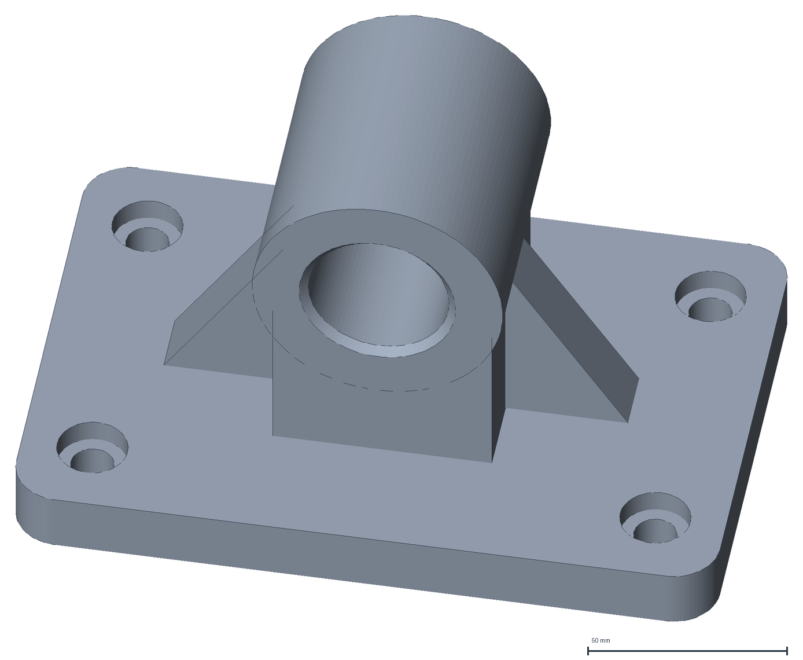
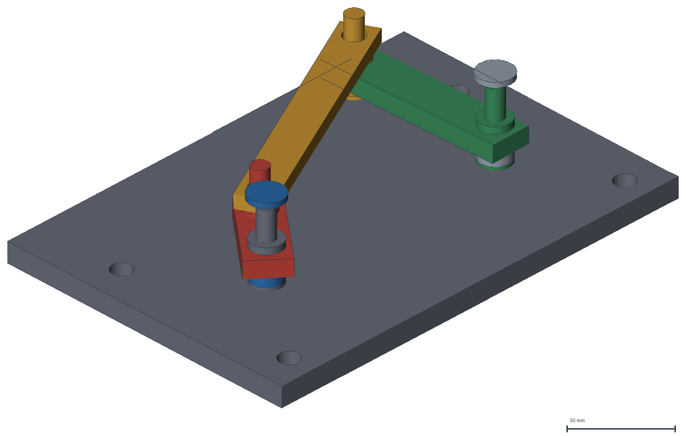
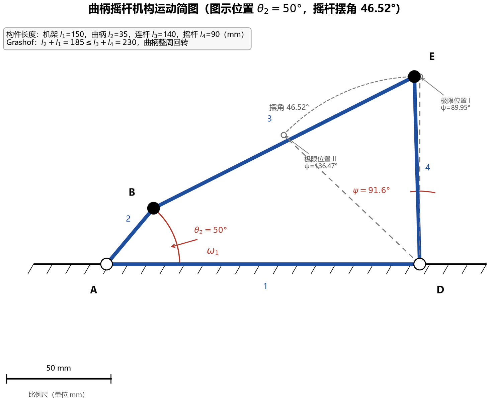
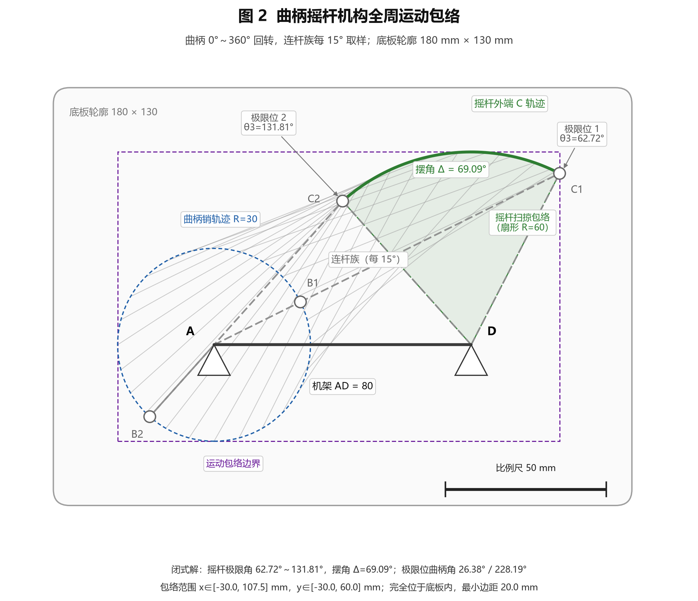
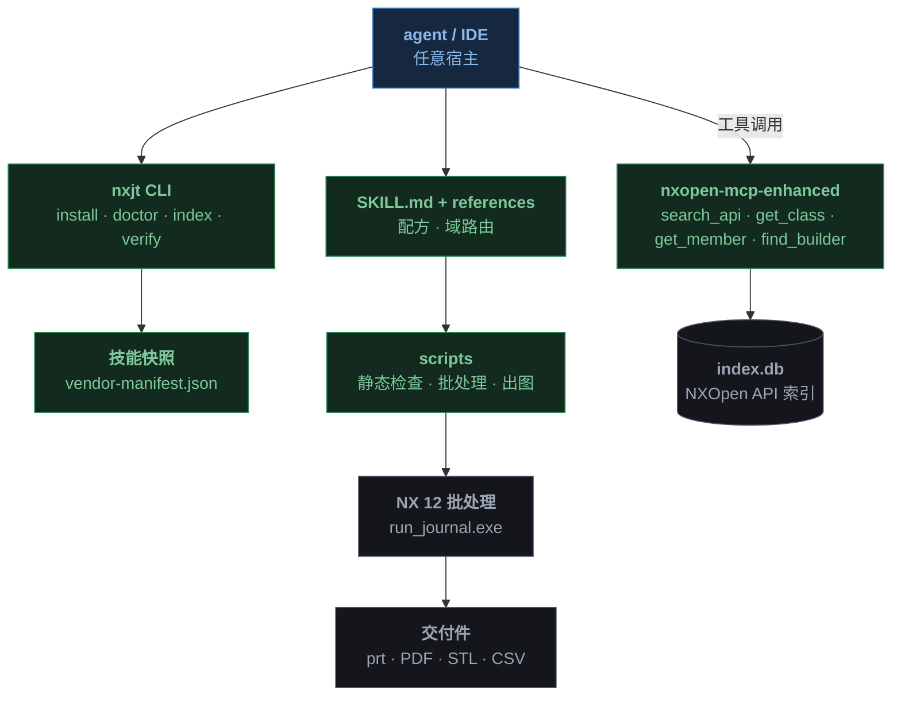

# nxopen-journal-toolkit

[English](README.en.md) | 中文

面向 NX 12 的 agent 工具包：技能 + API 检索 MCP，一条命令安装。

`Windows 11` · `NX 12 (12.0.0.27)` · `Python 3.11+` · `Skill 1.7.0` · `v1.0.0` · `MIT`

## 目录

- [背景](#背景)
- [特性](#特性)
- [架构](#架构)
- [安装](#安装)
- [行为说明与已知限制](#行为说明与已知限制)
- [测试](#测试)
- [许可证](#许可证)

## 背景

`nxopen-journal` 负责“怎么写 journal、怎么在 NX 里跑、产物怎么验”；`nxopen-mcp-enhanced` 负责“NXOpen .NET API 到底长什么样”。前者让 agent 有可执行的方法，后者让 agent 不靠记忆猜 API。两者独立可用，合起来才是本工具包的完整形态。

只装技能时，agent 仍可能把 `CreateExtrudeBuilder` 写成不存在的重载；只装 MCP 时，agent 知道 API 但不知道 NX 12 的批处理边界。本工具包把技能快照与 MCP 装进同一条安装链路，`nxjt doctor` 同时检查技能、索引与 MCP 配置，避免“技能能跑但检索服务没起来”的半安装状态。组件清单见 [docs/VERSIONS.md](docs/VERSIONS.md)，变更见 [CHANGELOG.md](CHANGELOG.md)。

## 特性

**一条命令安装**
`nxjt install` 放置技能快照、写入宿主 MCP 配置或打印可合入的片段；`nxjt index` 建 API 索引；`nxjt verify` 做技能自检与真实 MCP 冒烟。两个包从 GitHub Release 用 `pip` 安装，未发布到 PyPI。

**技能：nxopen-journal**
覆盖三维建模、装配、Drafting/国标出图、有限元、运动仿真、逆向重建六个域。每个域统一为“agent 写 journal → 批处理执行 → 核对产物”，带静态检查 `check_journal.py`、用例标准层 `nxlib/`、离线出图链 `render/` 与 51 个带判定的 NX 回归用例。覆盖范围与边界见[技能 README](https://github.com/EVOL233awa/nxopen-journal)。

**MCP：nxopen-mcp-enhanced**
四个工具：`search_api`（混合语义检索）、`get_class`（成员与继承链，分页）、`get_member`（精确签名与参数）、`find_builder`（CAM 工序 → Builder 骨架）。增强 fork 相对上游增加 OpenAI 兼容远程嵌入、可选重排、离线精确名回退与 `get_class` 分页；细节见 [fork README](https://github.com/EVOL233awa/nxopen-mcp-enhanced)。

**自检**
`nxjt doctor` 检查 `NX_HOME`、`run_journal.exe`、NXOpen XML、索引、嵌入后端、MCP 配置与组件版本；`nxjt verify` 启动真实 MCP 并查一个成员，不是只看 `--help`。

**示例产物**
以下九张图都是本工具包的实际产物，不是示意图：八张来自 1.0.0，国标装配图来自技能 1.7.0。生成环境：即 ZCode + DeepSeek-V4.1-Flash-1017（max）+ nxopen-journal-toolkit 1.0.0；NX 12.0.0.27，Windows 11，宿主 Python 3.12.0，NX 内嵌 Python 3.6.1。三维图由 STL 在 NX 外离线渲染，工程图为 NX Drafting 直接导出的 PDF 转图，有限元/运动/机构图为求解数据或闭式解在宿主绘制。

| 三维建模：轴承支座（180×120×16，Ø64×70 凸台、Ø36 通孔、双筋、4×Ø18 沉孔） | 装配：曲柄摇杆总成（7 类 18 件） |
|---|---|
|  |  |

建模件为单实体 40 面，由底板、支撑柱、水平凸台、两条三角筋与孔包沉头孔组成；装配件为 200×140×12 底板、AB=30、BC=90、CD=80、AD=120 的曲柄摇杆机构，共 18 个组件实例。

| Drafting：A3 零件图（三视图、12 条尺寸、Ø44/Ø20/2×Ø18） | 国标装配图：A3（三视图、A-A 剖视、7 个序号球、6 条装配尺寸、完整标题栏） |
|---|---|
|  |  |

左图为 160×100×16 安装板，Ø44×8 凸台、Ø20 通孔、4×Ø9 角孔与 2×Ø18 沉孔，单实体 19 面；三视图、尺寸道位、中心线与 PDF 由 `gb_drawing` 生成，PDF 文本层核对过 160/120/100/60/50/16/8/80/44/20/18/9。右图为第一角 A3 装配图，比例 1:2，序号 1–7 与明细栏对应，6 条装配尺寸，`audit_gb_assembly(strict=True)` 通过。

| 有限元：SOL 101 悬臂梁（200×20×20，2.5 mm CTETRA(10)，40199 节点） |
|---|
|  |

固定端 6DOF、自由端 −Z 500 N；自由端挠度 FEA 0.4838 mm vs 梁理论 0.4832 mm（比值 1.0011），x=25…190 表面 von Mises 与理论最大偏差 0.533%；根部应力集中区单独标注，不作判据。

| 运动仿真：平面四杆（AB=30、BC=85、CD=50、AD=100，721 帧） |
|---|
|  |

曲柄 −360 °/s、1 s/720 步；摇杆摆角 NX 75.5113° vs 闭式解 75.5091°（差 0.0022°），角速度峰值 239.363 vs 239.362 °/s，每转换向 2 次。关节反力只作 API 通路验证，不作物理判据。

| 机构运动简图：曲柄摇杆（30/90/60/80，θ=70°） | 运动包络：整周扫描（连杆族 15° 取样） |
|---|---|
|  |  |

简图标出两个极限位置与摇杆摆角 69.09°；包络图给出曲柄销轨迹（R=30）、C 点轨迹与连杆族，全周包络 x=−30…107.5、y=−30…60 mm，全部落在 180×130 底板内。

| 逆向重建：面表 → 参数 → 命名表达式（16 面参考件） |
|---|
|  |

参考件 120×80×20，带 60×40×8 矩形腔、Ø20×12 通孔与 4×Ø6×20 孔；仅从 `face_table.csv` 推断出全部参数，用 8 个命名表达式重建。体积 166768.142 mm³ 两件一致，包盒差 0，面数 16=16，孔组 5=5，G0–G9 通过（G7 因无圆角为 N/A）。

G0–G9 是技能对逆向重建件的十项硬门，每门只取 PASS / FAIL / BLOCKED / N/A：

| 门 | 判据 |
|---|---|
| G0 单实体可读 | 体数 1、体积 > 0、面表逐面可读、两侧都能导出 STL |
| G1 截面轮廓 | 每结构至少一站，逐站 IoU ≥ 0.95、面积差 ≤ 5%、无开环 |
| G2 孔与锥面 | 圆柱/圆锥组全部入账；半径 ≤ 0.025 mm、孔心 ≤ 0.05 mm、轴角 ≤ 0.1°、长度 ≤ 0.1 mm、半角 ≤ 0.1° |
| G3 体积 | 相对差 ≤ 0.1% |
| G4 包盒 | 位置差与尺寸差各 ≤ 0.05 mm |
| G5 四视图 | top/front/side/iso 轮廓 IoU ≥ 0.99 |
| G6 双向偏差 | RMS ≤ 0.8 mm、P95 ≤ 1.8 mm |
| G7 圆角覆盖 | 面与跑道覆盖 ≥ 70%（0.10 mm）、半径误差 ≤ 0.025 mm、局部 P95 ≤ 0.10 mm；原件无圆角记 N/A |
| G8 表达式可编辑 | 命名表达式逐个 ×1.1 后体积全变，活率 1.0、无缺建参数 |
| G9 特征树结构 | 特征数 ≤ 4×结构数+12、单型占比 ≤ 0.50、树深 ≤ 8 |

## 架构



安装形态：

```text
nxopen-journal-toolkit/
├── src/nxopen_journal_toolkit/
│   ├── cli.py                    nxjt 命令实现
│   └── _skill/
│       ├── nxopen_journal/       技能只读快照（发布时同步）
│       └── vendor-manifest.json  技能版本、commit、逐文件 SHA-256
├── tools/sync_skill.py           从技能仓库导出快照并校验
├── docs/
│   ├── INSTALL.md                安装与嵌入后端细节
│   ├── INSTALL.en.md             英文版安装说明
│   ├── VERSIONS.md               组件 BOM 与更新规则
│   └── images/                   示例产物图
└── tests/                        CLI 与安装链测试
```

技能快照不是手写副本：`tools/sync_skill.py --ref <commit>` 从技能仓库 `git archive` 导出并写入 manifest，`--check` 逐文件比对 SHA-256。技能更新时先改技能仓库，再同步快照，避免两份源码漂移。

## 安装

快速开始：把下面整段复制给任意宿主的 agent；它负责检查环境、安装工具包、把技能放进自己的技能目录、注册 MCP、选择嵌入后端、建索引并自检。跑完后技能与 MCP 在宿主里可直接使用。变更见 [CHANGELOG.md](CHANGELOG.md)。

```text
任务：在本机安装并验证 nxopen-journal-toolkit（nxopen-journal 技能 + nxopen-mcp-enhanced MCP），
结束后技能与 MCP 在宿主里可直接使用。

仓库：
- 技能：https://github.com/EVOL233awa/nxopen-journal
- MCP：https://github.com/EVOL233awa/nxopen-mcp-enhanced
- 工具包：https://github.com/EVOL233awa/nxopen-journal-toolkit

宿主：按你自己的技能目录与 MCP 配置格式操作，不要假定宿主是某个特定 agent。

环境前提（缺一即停并报告，不要跳过）：
- Windows 11。
- Siemens NX 12；NX_HOME 指向安装根（默认 D:\UG-NX12），%NX_HOME%\NXBIN\run_journal.exe 存在。
- 宿主 Python 3.11+（python -V）。NX journal 由 NX 内嵌 Python 3.6.1 执行，与宿主 Python 无关。

步骤：
1. 安装工具包（未发布到 PyPI，从 GitHub Release 安装；先装 MCP，再装工具包）：
   python -m pip install https://github.com/EVOL233awa/nxopen-mcp-enhanced/releases/download/v1.0.0/nxopen_mcp_enhanced-1.0.0-py3-none-any.whl
   python -m pip install https://github.com/EVOL233awa/nxopen-journal-toolkit/releases/download/v1.0.0/nxopen_journal_toolkit-1.0.0-py3-none-any.whl
   可选：python -m pip install pythonnet（get_class 显示继承链）。
2. 放置技能：
   - 快照在已安装包的 _skill/nxopen_journal 下，用下面一行取得绝对路径：
     python -c "import nxopen_journal_toolkit, pathlib; print(pathlib.Path(nxopen_journal_toolkit.__file__).parent / '_skill' / 'nxopen_journal')"
   - 把它复制或链接为 <你的技能目录>/nxopen-journal，目录名保持 nxopen-journal。
   - 若宿主属于 nxjt 支持的目录约定，也可用 nxjt install --target <宿主> 自动放置
     （支持的取值见 nxjt install --help）。
   - 目标已存在先备份或改用链接；不要用 --force 删除 git 仓库。
3. 注册 MCP（stdio）：
   - 命令：nxopen-mcp-enhanced serve --db <索引路径>；
     默认索引 C:\Users\<you>\.nxopen-mcp-enhanced\index.db。
   - 按宿主的 MCP 配置格式注册，通用 JSON：
     {"mcpServers":{"nxopen":{"command":"nxopen-mcp-enhanced","args":["serve","--db","<索引路径>"]}}}
   - 若宿主受 nxjt 支持，nxjt install --target <宿主> 会写入配置或打印可直接合入的片段；
     否则按宿主文档手写上述 JSON。
4. 选择嵌入后端并建索引：
   - 远程（推荐，不下载模型）：需要 OpenAI 兼容服务。把以下变量写入 MCP 配置的 env，
     并在建索引的 shell 里设为同样的值：
     NXOPEN_MCP_EMBEDDER=remote
     NXOPEN_MCP_EMBED_URL=https://api.siliconflow.cn
     NXOPEN_MCP_EMBED_MODEL=BAAI/bge-m3
     NXOPEN_MCP_EMBED_API_KEY=<向用户索取；不要回显或写入日志>
     NXOPEN_MCP_RERANK=1
     NXOPEN_MCP_RERANK_URL=https://api.siliconflow.cn/v1/rerank
     NXOPEN_MCP_RERANK_MODEL=BAAI/bge-reranker-v2-m3
     NXOPEN_MCP_RERANK_API_KEY=<同 API key>
   - 本地（离线）：python -m pip install FlagEmbedding，首次下载约 2 GB。
   - 建索引：nxjt index --workers <核数>（默认使用 NX_HOME，缺省 D:\UG-NX12）；
     已有上游索引可复用：nxjt index --db C:\Users\<you>\.nxopen-mcp\index.db
     （嵌入模型必须一致，否则重建）。全量索引可能数小时：后台运行并定期报告进度，不要中断。
5. 自检：
   - nxjt doctor：检查 NX_HOME、run_journal.exe、NXOpen XML、索引、嵌入后端、MCP 可执行。
     其中 MCP 配置检查针对工具包默认的写入目标；你的宿主不使用该目标时该项会失败，属预期，
     改为核对你自己的 MCP 配置。
   - nxjt verify --skill-dir <你的技能目录>：技能自检 + 真实 MCP stdio 冒烟
     （get_member "Tag"）。技能目录不在 CLI 探测范围时必须传 --skill-dir；冒烟读取的索引
     路径来自工具包默认的 MCP 配置，索引不在默认路径时以第 3 条的 get_member 调用为准。
   - 在宿主的 MCP 客户端里实际调用 get_member（参数 "Tag"），确认返回成员；
     再调用 search_api（查询 "create extrude builder"），确认语义检索可用。
6. 报告：
   - 安装路径、工具包与技能版本、索引路径与大小、MCP 注册位置、doctor/verify 与两项 MCP 自检结果。
   - 失败项附原始输出末尾 50 行；不要只报退出码；不要声称未验证的步骤已通过；不要回显 API key。
```

也可以按下面的步骤手动安装。

### 前置条件

| 项 | 要求 |
|---|---|
| 操作系统 | Windows 11（NX 12 批处理与 MinGW/Git Bash 路径已验证） |
| NX | Siemens NX 12（验证版本 12.0.0.27）及 NXOpen 自动化接口 |
| `NX_HOME` | 指向 NX 安装根，默认 `D:\UG-NX12` |
| Python | 宿主 3.11+（`nxjt` 与 MCP）；NX journal 由 NX 内嵌 Python 3.6.1 执行 |
| 磁盘 | 技能约 4 MB；索引约 0.4 GB；本地嵌入路线另需约 2 GB 模型 |

### 从 Release 安装

本仓库与 `nxopen-mcp-enhanced` 都未发布到 PyPI，安装包挂在 GitHub Release。MCP 是工具包的依赖，先装 MCP 再装工具包，`pip` 才能在本机满足依赖：

```bash
python -m pip install https://github.com/EVOL233awa/nxopen-mcp-enhanced/releases/download/v1.0.0/nxopen_mcp_enhanced-1.0.0-py3-none-any.whl
python -m pip install https://github.com/EVOL233awa/nxopen-journal-toolkit/releases/download/v1.0.0/nxopen_journal_toolkit-1.0.0-py3-none-any.whl
```

开发或需要 extras 时从源码安装（editable），顺序同样先 MCP 后工具包：

```bash
git clone https://github.com/EVOL233awa/nxopen-mcp-enhanced
python -m pip install -e "nxopen-mcp-enhanced[reflect]"
git clone https://github.com/EVOL233awa/nxopen-journal-toolkit
cd nxopen-journal-toolkit
python -m pip install -e .
```

### 放置技能与注册 MCP

`nxjt install` 按宿主放置技能，MCP 配置的写入或打印范围如下：

| `--target` | 技能目录 | MCP 配置 |
|---|---|---|
| `codex` | `%USERPROFILE%\.codex\skills` | 打印 Codex `config.toml` 片段 |
| `claude` | `%USERPROFILE%\.claude\skills` | 打印 Claude `.mcp.json` 片段 |
| `all` | 所有内置宿主目录 | 写入默认 MCP 配置入口，并打印其余片段 |
| `auto`（默认） | 探测已存在的内置宿主目录，未探测到回退默认目标 | 同探测结果 |

其余目标名与目录以 `nxjt install --help` 为准；表中未列出的宿主手动放置。

```bash
nxjt install                       # auto
nxjt install --target codex        # 换 claude / all 等
nxjt install --skill-only          # 不碰 MCP 配置
```

`nxjt install` 写 MCP 配置前自动备份，内容不变时跳过；技能目录已存在时默认跳过，`--force` 覆盖，但目标是 git 仓库时拒绝删除。

宿主不在上表时（其他 agent、自建客户端）：把内置技能快照复制或链接到自己的技能目录，目录名保持 `nxopen-journal`；MCP 按宿主的 stdio server 格式注册，通用 JSON：

```json
{"mcpServers":{"nxopen":{"command":"nxopen-mcp-enhanced","args":["serve","--db","<索引路径>"]}}}
```

索引路径默认 `%USERPROFILE%\.nxopen-mcp-enhanced\index.db`，与 `nxjt index --db` 保持一致。

### 选择嵌入后端

工具包默认依赖不强制安装本地模型，建索引前先选一条：

```bash
# 远程：硅基流动免费模型（BAAI/bge-m3 + BAAI/bge-reranker-v2-m3，不下载模型）
nxjt config embed --provider remote

# 或本地 BGE-M3（离线路线；首次使用下载约 2 GB）
pip install FlagEmbedding
```

远程路线不装 `FlagEmbedding`；免费档有固定 Rate Limits、需实名认证，`Pro/` 前缀同名模型收费。`nxjt config embed --provider remote` 会同时打开重排（Recall@5 57.53% → 69.86%，73 条 golden）。

`nxjt config embed` 交互写入 base URL、嵌入模型、API key、rerank URL 与模型，供 `nxjt index` 沿用；它写入的是工具包默认的 MCP 配置入口。宿主不使用该入口时改用 `NXOPEN_MCP_*` 环境变量：建索引前在 shell 里设置，并把同一组变量写入宿主 MCP 配置的 `env`。切回本地用 `--provider local`。本地与云端部署同一嵌入模型时，已建索引无需重建。

| 配置项 | 说明 | 默认值 |
|---|---|---|
| `NX_HOME` | NX 安装根 | `D:\UG-NX12` |
| `NXOPEN_MCP_EMBEDDER` | `remote` / `openai` 用 OpenAI 兼容服务；`ollama` 用 Ollama；不设用本地 BGE-M3 | 未设置（本地） |
| `NXOPEN_MCP_EMBED_URL` | 远程嵌入 base URL | `http://127.0.0.1:11436` |
| `NXOPEN_MCP_EMBED_MODEL` | 远程嵌入模型名 | `bge-m3` |
| `NXOPEN_MCP_EMBED_API_KEY` | 远程嵌入 bearer token | 空 |
| `NXOPEN_MCP_RERANK` | 设为 `1` / `true` / `on` 开启重排 | 关闭 |
| `NXOPEN_MCP_RERANK_URL` | 重排端点 | `http://127.0.0.1:8000/v1/rerank` |
| `NXOPEN_MCP_RERANK_MODEL` | 重排模型名 | 空 |
| `NXOPEN_MCP_RERANK_API_KEY` | 重排 bearer token | 空 |

未安装 FlagEmbedding 且未配置远程服务时，`nxjt index` 会失败，`nxjt doctor` 会给出 warn。`pythonnet` 只影响 `get_class` 是否显示继承成员，按需安装。

### 建索引

```bash
nxjt index                  # 使用 NX_HOME（默认 D:\UG-NX12）
nxjt index --nx-path "C:\Siemens\NX12.0" --workers 4
```

索引是 NXOpen XML 文档的向量库，写入 MCP 配置中 `--db` 指向的同一路径。全量 NX 12 文档约 10 万成员，8 核笔记本 CPU 上本地 BGE-M3 嵌入可能需要数小时，建议过夜跑；`--workers` 并行提交批次。已有上游 `nxopen-mcp` 索引且嵌入模型一致时可直接复用：

```bash
nxjt index --db C:\Users\<you>\.nxopen-mcp\index.db
```

### 自检

```bash
nxjt doctor     # NX_HOME、run_journal.exe、managed XML、索引、MCP 配置、组件版本
nxjt verify     # check_repo.py + 真实 MCP stdio 冒烟（启动 server 调 get_member）
nxjt verify --nx  # 追加 NX 回归套件（54 个用例文件，其中 51 个带判定，耗时长）
```

`verify` 任一项失败即非零退出；冒烟会用配置里的 `--db` 真正启动 MCP 并查一个成员。技能目录不在 CLI 探测的 `%USERPROFILE%\.codex\skills`、`%USERPROFILE%\.claude\skills` 时，`verify` 需传 `--skill-dir <技能目录>`。`doctor` 的 MCP 配置检查针对工具包默认的写入目标；宿主不使用该目标时该项会失败，属预期，以宿主自身的 MCP 配置和 `get_member` 实际调用为准。

### 命令

| 命令 | 作用 |
|---|---|
| `nxjt install [--target <宿主>] [--force] [--skill-only]` | 复制技能；内置支持的宿主写入或打印 MCP 配置片段（备份、幂等、拒绝删 git 仓库） |
| `nxjt doctor` | 检查 NX、`run_journal.exe`、`NXBIN\managed` XML、索引、MCP 配置、BOM 版本 |
| `nxjt index [--nx-path ...] [--db ...] [--workers N]` | 用内置 MCP 构建/增量写入索引，沿用配置里的嵌入环境 |
| `nxjt verify [--nx] [--skill-dir ...]` | 技能仓库自检 + MCP stdio 冒烟；`--nx` 跑 NX 回归套件 |
| `nxjt config embed --provider local\|remote` | 切换本地 BGE-M3 与 OpenAI 兼容远程嵌入/重排 |

## 行为说明与已知限制

- 当 `nxjt install` 写入 MCP 配置时：先备份；内容不变时跳过；技能目录已存在时默认跳过。
- 当目标是 git 仓库时：拒绝用 `--force` 删除；改用链接或手工备份。
- 当宿主不在内置目录表时：手工把技能快照放进宿主技能目录，并按宿主的 stdio 格式注册 MCP。
- 当远程嵌入不可达时：整串名与查询中的驼峰标识符退回本地精确匹配；重排不可达时等 15 s 超时后回退到未重排顺序。
- 当索引不在默认路径时：`doctor`/`verify` 的检查会失败，属预期；以宿主自身的 MCP 配置和 `get_member` 实际调用为准。
- 只验证 NX 12。NX 2506 的线程 API、表达式 `.Value`、多体质量与 Block 布尔行为不同，技能配方按 NX 12 写死。
- 索引不是开箱即用：本包不附带索引和 NX 文档；没有索引时四个工具都不可用。
- 未发布到 PyPI：从 GitHub Release 安装，源码安装见[安装](#安装)。
- 域内限制（批处理不能截图、逆向重建不保证复杂件、FEA/Motion 需要相应许可、阵列类型边界）见[技能 README](https://github.com/EVOL233awa/nxopen-journal#行为说明与已知限制)。

## 测试

```bash
python -m pytest -q                 # CLI / 安装链测试
python tools/sync_skill.py --check  # 技能快照与 manifest 一致
python -m build                     # 构建 wheel / sdist
nxjt verify                         # 安装后自检 + MCP 冒烟
```

改技能时在技能仓库提交，再 `python tools/sync_skill.py --ref <commit>`；不要把 `_skill/` 下的快照当源码直接编辑（manifest 会拦下）。改 CLI 后至少跑 `pytest` 与一次真实 `nxjt verify`。

## 许可证

- 技能：`nxopen-journal`（MIT），源头仓库 <https://github.com/EVOL233awa/nxopen-journal>。
- MCP：`nxopen-mcp-enhanced`（MIT），fork 自 <https://github.com/mingfeng6684/nxopen-mcp>，增强仓库 <https://github.com/EVOL233awa/nxopen-mcp-enhanced>。
- 本工具包：MIT。许可全文见 [LICENSE](LICENSE) 与 [LICENSES/](LICENSES/)；来源声明见 [NOTICE](NOTICE)。
- NX、NXOpen、NX Nastran 是 Siemens 的商标；本仓库不分发 Siemens 的文档、二进制或索引。
