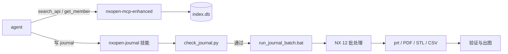
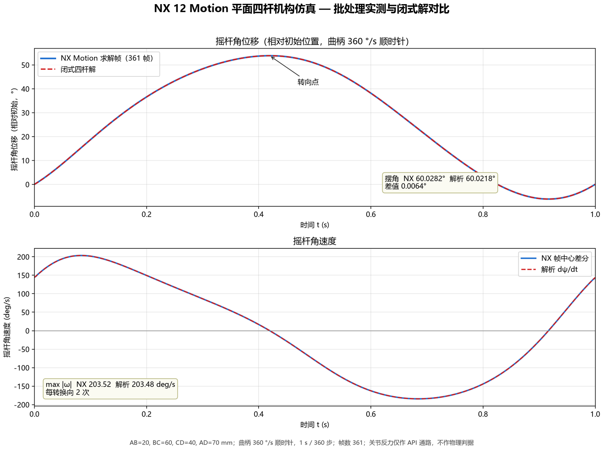
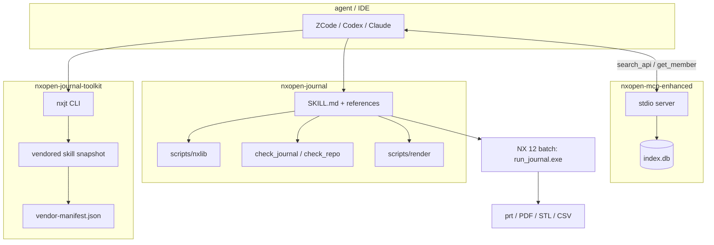

# nxopen-journal-toolkit

面向 Siemens NX 12 的 agent 工具包：**一个技能 + 一个 MCP 检索服务**，一条命令完成安装。

`nxopen-journal` 负责“怎么写 journal、怎么在 NX 里跑、产物怎么验”；`nxopen-mcp-enhanced` 负责
“NXOpen .NET API 到底长什么样”。前者让 agent 有可执行的方法，后者让 agent 不靠记忆猜 API。
两者独立可用，合起来才是本工具包的完整形态。

当前版本 **1.0.0**（组件清单见 [docs/VERSIONS.md](docs/VERSIONS.md)）。

## 目录

- [两个组成部分](#两个组成部分)
- [安装](#安装)
- [命令](#命令)
- [agent 工作流](#agent-工作流)
- [示例产物](#示例产物)
- [架构](#架构)
- [版本与兼容性](#版本与兼容性)
- [已知限制](#已知限制)
- [来源与许可](#来源与许可)
- [开发](#开发)

## 两个组成部分

| 组件 | 作用 | 形态 | 单独安装 |
|---|---|---|---|
| [`nxopen-journal`](https://github.com/EVOL233awa/nxopen-journal) | NX 12 journal 技能：建模、装配、Drafting、FEA、Motion、逆向重建，以及静态检查与回归套件 | 技能目录（`SKILL.md` + `references/` + `scripts/`） | 复制技能目录即可 |
| [`nxopen-mcp-enhanced`](https://github.com/EVOL233awa/nxopen-mcp-enhanced) | NXOpen .NET API 检索 MCP：类/成员/签名/Builder 配方，支持本地或远程嵌入与重排 | MCP stdio server（`nxopen-mcp-enhanced serve`） | `pip install nxopen-mcp-enhanced`（发布后） |

### 技能：nxopen-journal

技能覆盖 NX 自动化的六个域，工作方式统一为“agent 写 journal → 批处理执行 → 核对产物”：

| 域 | 能力 |
|---|---|
| 三维建模 | 草图与驱动尺寸、拉伸/旋转/扫掠、布尔、抽壳与拔模、九类阵列、孔包、圆角与滚球角面、图层 |
| 装配 | 组件加载与定位约束、可拖动机构、转动副、干涉检查、装配图三视图 |
| Drafting / 国标出图 | 三视图与投影视图、局部放大、剖视（阶梯/半剖/旋转）、尺寸与中心线、A3/A4 图框、标题栏、明细栏、技术要求、PDF |
| 有限元 | NX Nastran SOL 101 静力、2D 壳网格、边界条件描述符、结果采样与手算对照 |
| 运动仿真 | 连杆、转动副、滑动副、齿轮连接器、驱动、求解、帧结果与速度/加速度读取 |
| 逆向重建 | 面表与结构目录、按测量截面重建、草图优先、双向精度验收、可编辑性检查 |

技能还带三样支撑：`scripts/check_journal.py`（按 NX 内嵌 Python 3.6 语法与已固化坑位做静态检查）、
`scripts/nxlib/`（15 个模块的用例标准层，回归用例直接 import）、`scripts/render/`（STL 离线渲染、
PDF 栅格化、裁边与比例尺）。技能仓库另有 50 个带判定的 NX 回归用例。

### MCP：nxopen-mcp-enhanced

上游是 [`mingfeng6684/nxopen-mcp`](https://github.com/mingfeng6684/nxopen-mcp)。本工具包使用增强
fork，四个工具：

| 工具 | 用途 |
|---|---|
| `search_api` | 混合检索（dense + 精确名通道）：不知道类名时用自然语言或中英混写查询 |
| `get_class` | 列出一个类的全部成员（含继承链），分页 `offset` / `limit`，默认 200 |
| `get_member` | 单个成员的精确签名、参数、返回类型、NX 版本与 license |
| `find_builder` | 由 CAM 工序名找 `*Builder` 类、创建方法与 Builder→Commit→Destroy 骨架 |

相对上游的改动：OpenAI 兼容远程嵌入、可选 `/v1/rerank` 重排、精确名离线回退、15 s 重排超时、
唯一名跳过重排，以及 `get_class` 分页。包名、模块名、命令与数据目录均已命名空间化，可与上游共存。
细节见 fork 仓库的 [README](https://github.com/EVOL233awa/nxopen-mcp-enhanced)。

### 为什么建议一起装

技能文档给的是“做法”，MCP 给的是“事实”。只装技能时，agent 仍可能把 `CreateExtrudeBuilder`
写成不存在的重载；只装 MCP 时，agent 知道 API 但不知道 NX 12 的批处理边界（例如哪些 builder
在 NX 12 上静默失效）。工具包把两者放进同一条安装链路，`nxjt doctor` 会同时检查技能、索引与
MCP 配置，避免“技能能跑但检索服务没起来”的半安装状态。

## 安装

### 前置

| 项 | 要求 |
|---|---|
| 操作系统 | Windows 11（NX 12 批处理与 MinGW/Git Bash 路径已验证） |
| NX | Siemens NX 12（当前验证版本 12.0.0.27）及 NXOpen 自动化接口 |
| `NX_HOME` | 指向 NX 安装根，默认 `D:\UG-NX12` |
| Python | 宿主 3.11+（`nxjt` 与 MCP）；NX journal 由 NX 内嵌 Python 3.6.1 执行 |
| 磁盘 | 技能约 4 MB；索引约 0.4 GB；本地嵌入模型另需约 2 GB |

### 从源码安装（当前状态）

本仓库尚未发布到 PyPI。先安装工具包本身，再由 `nxjt` 安装技能与 MCP：

```bash
git clone https://github.com/EVOL233awa/nxopen-journal-toolkit
cd nxopen-journal-toolkit
python -m pip install -e .
```

`pip install -e .` 会一并安装 `nxopen-mcp-enhanced`。如果 MCP 也来自本地源码，先把 fork 仓库
装上（`python -m pip install -e D:\nxopen-mcp-enhanced`），再安装本包，避免依赖解析去 PyPI 找同名包。

发布后可直接：

```bash
pip install nxopen-journal-toolkit
```

### 选择嵌入后端

工具包默认依赖不强制安装 2 GB 的本地模型，建索引前先选一条：

```bash
# 本地 BGE-M3（默认路线；首次使用下载约 2 GB）
pip install "nxopen-mcp-enhanced[embed]"

# 或 OpenAI 兼容远程服务（不装本地模型；装完本包后配置）
nxjt config embed --provider remote
```

未安装 FlagEmbedding 且未配置远程服务时，`nxjt index` 会失败，`nxjt doctor` 会给出 warn。
`[reflect]`（pythonnet）只影响 `get_class` 是否显示继承成员，按需安装。

### 一键安装技能与 MCP

```bash
nxjt install --target zcode
```

它会：

1. 把内置的技能快照复制到 `~/.codex/skills/nxopen-journal`（ZCode 与 Codex 共用该目录）；
2. 在 `~/.zcode/cli/config.json` 写入/更新 `nxopen` MCP server，命令指向 `nxopen-mcp-enhanced`；
3. 写配置前自动备份；内容未变化时跳过；目标目录是 git 仓库时拒绝 `--force`，避免误删开发副本。

其他宿主：

```bash
nxjt install --target codex     # 只复制技能，打印 Codex 的 MCP 配置片段
nxjt install --target claude    # 只复制技能，打印 Claude 的 MCP 配置片段
nxjt install --target all       # 复制到 zcode / codex / claude
nxjt install --skill-only       # 不碰 MCP 配置
```

### 建索引

```bash
nxjt index                  # 使用 NX_HOME（默认 D:\UG-NX12）
nxjt index --nx-path "C:\Siemens\NX12.0" --workers 4
```

索引是 NXOpen XML 文档的向量库，写入 MCP 配置中 `--db` 指向的同一路径。全量 NX 12 文档约
10 万成员，8 核笔记本 CPU 上本地 BGE-M3 嵌入可能需要数小时，建议过夜跑；机器内存通道越多、
`--workers` 收益越明显。已有上游 `nxopen-mcp` 索引时可直接复用：

```bash
nxjt index --db C:\Users\<you>\.nxopen-mcp\index.db
```

### 自检

```bash
nxjt doctor     # NX_HOME、run_journal.exe、managed XML、索引、MCP 配置、组件版本
nxjt verify     # check_repo.py + 真实 MCP stdio 冒烟（启动 server 调 get_member）
nxjt verify --nx  # 追加 NX 回归套件（50 个带判定的用例，耗时长）
```

`verify` 任一项失败即非零退出；冒烟会用配置里的 `--db` 真正启动 MCP 并查一个成员，不是只看
`--help`。

### 远程嵌入与重排（可选）

默认本地 BGE-M3。若已有 OpenAI 兼容的嵌入/重排服务（例如硅基流动）：

```bash
nxjt config embed --provider remote
```

交互写入 base URL、嵌入模型、API key、rerank URL 与模型；后续 `nxjt index` 会沿用同一组
`NXOPEN_MCP_*` 环境变量。切回本地：`nxjt config embed --provider local`。

远程模式不需要下载 2 GB 模型，但查询依赖网络：嵌入不可达时，整串名（含 `Part`、`Session`
这类单字名与全限定名）和查询中的驼峰标识符退回本地精确匹配；重排不可达时等 15 s 超时后
回退到未重排顺序。

## 命令

| 命令 | 作用 |
|---|---|
| `nxjt install [--target zcode\|codex\|claude\|all\|auto] [--force] [--skill-only]` | 复制技能；ZCode 目标同时写 MCP 配置（备份、幂等、拒绝删 git 仓库） |
| `nxjt doctor` | 检查 NX、`run_journal.exe`、`NXBIN\managed` XML、索引、MCP 配置、BOM 版本 |
| `nxjt index [--nx-path ...] [--db ...] [--workers N]` | 用内置 MCP 构建/增量写入索引，沿用配置里的嵌入环境 |
| `nxjt verify [--nx] [--skill-dir ...]` | 技能仓库自检 + MCP stdio 冒烟；`--nx` 跑 NX 回归套件 |
| `nxjt config embed --provider local\|remote` | 切换本地 BGE-M3 与 OpenAI 兼容远程嵌入/重排 |

## agent 工作流

安装完成后，agent 的典型链路：



一个具体例子：

1. 用户说“建一个 160×100 的轴承支座，带凸台、筋板和沉头孔，再出一张 A3 零件图”。
2. agent 用 `search_api("create extrude builder")` 找到 `ExtrudeBuilder`，用 `get_member`
   核对 `Limits.StartExtend.Value` 与 NX 版本。
3. agent 读技能的 `references/modeling.md`，按草图—拉伸—布尔—孔的顺序写 journal。
4. `python scripts/check_journal.py job.py` 按 NX 内嵌 Python 3.6 语法与坑位规则做静态检查。
5. `scripts/run_journal_batch.bat job.py workdir` 在 NX 12 中批处理执行。
6. 产物用 `scripts/render/` 导出 STL/PDF 图，用 `nxlib.measure` 与交付件门核对体积、包盒、面表。

## 示例产物

以下九张图都是本工具包 1.0.0 在 NX 12 批处理中实际跑出的结果，不是示意图。生成环境：

```text
zcode, deepseek-v4.1flash1017(max), toolkit1.0.0版本
```

即 ZCode + DeepSeek-V4.1-Flash-1017（max）+ nxopen-journal-toolkit 1.0.0；NX 12.0.0.27，
Windows 11，宿主 Python 3.12.0，NX 内嵌 Python 3.6.1。三维图由 STL 在 NX 外离线渲染，
工程图为 NX Drafting 直接导出的 PDF 转图，有限元/运动/机构图为求解数据或闭式解在宿主绘制。

| 三维建模：轴承支座（160×100×14，凸台 Ø64、Ø40 通孔、双筋、4×Ø10 沉孔 Ø18×6） | 装配：曲柄摇杆总成（7 类 18 件） |
|---|---|
|  |  |

建模件由草图拉伸、圆台凸台、三角筋与孔包沉头孔组成，单实体 33 面；图由导出的 STL 渲染，
带 20 mm 比例尺。装配件为底板 260×180×12、曲柄 35、连杆 140、摇杆 90、机架 150 的曲柄摇杆
机构，含 4 个轴套、8 根销轴与 2 个端盖，共 18 个组件实例。

| Drafting：A3 零件图（三视图、外形/孔距/厚度、Ø64/Ø40、沉孔引线） | 国标出图：A3 装配图（图框、标题栏、7 行明细栏、技术要求） |
|---|---|
|  |  |

左图的三视图、尺寸道位、中心线与 PDF 全部由 `gb_drawing` 生成，导出后用 PDF 文本层核对过
数值（160/120/100/70/14/Ø64/Ø40）。右图为第一角 A3 装配图，比例 1:2，明细栏 7 行与 18 件
组件对应，技术要求置于明细栏上方。

| 有限元：SOL 101 悬臂梁（120×12×8，2 mm CTETRA(10)，14998 节点） |
|---|
|  |

固定端 6DOF、自由端 −200 N；自由端挠度 FEA 1.0839 mm vs 梁理论 1.0873 mm（比值 0.997），
底面纤维 von Mises 在中段与理论重合；根部 x<2H 的应力集中区单独标注，不作判据。全局峰值
216.5 MPa 出现在固定端角点，属约束奇异。

| 运动仿真：平面四杆（AB=20、BC=60、CD=40、AD=70，361 帧） |
|---|
|  |

曲柄 360 °/s 顺时针、1 s/360 步；摇杆摆角 NX 60.0282° vs 闭式解 60.0218°（差 0.0064°），
角速度峰值 203.52 vs 203.48 °/s，每转换向 2 次。关节反力只作 API 通路验证，不作物理判据
（平面四杆的四个转动副是静不定）。

| 机构运动简图：ZA 曲柄摇杆（150/35/140/90，θ=50°） | 运动包络：整周扫描（步长 2°） |
|---|---|
|  |  |

简图标出两个极限位置与摇杆摆角 46.52°；包络图给出 B 点轨迹（Ø70）、E 点轨迹与连杆族，
E 点包络 x=14.8…80.1、y=62.0…90.0 mm，全部落在 260×180 底板内。

| 逆向重建：面表 → 参数 → 草图拉伸（16 面参考件） |
|---|
|  |

参考件 100×70×22，带 60×36×8 矩形腔、Ø30 通孔与 4×Ø9 孔；仅从 `face_table.csv` 推断出全部
参数，用 12 个命名表达式重建。体积 121225.665 mm³ 两件一致（Δ 3.6e-14%），包盒差 0，
面数 16=16，STL 三角面 1188=1188。

## 架构



安装形态：

```text
nxopen-journal-toolkit/
├── src/nxopen_journal_toolkit/
│   ├── cli.py                    nxjt 命令实现
│   └── _skill/
│       ├── nxopen_journal/       技能只读快照（发布时同步）
│       └── vendor-manifest.json  技能版本、commit、逐文件 SHA-256
├── tools/sync_skill.py           从技能仓库导出快照并校验
├── docs/
│   ├── INSTALL.md                安装与嵌入后端细节
│   ├── VERSIONS.md               组件 BOM 与更新规则
│   └── images/                   示例产物图
└── tests/                        CLI 与安装链测试
```

技能快照不是手写副本：`tools/sync_skill.py --ref <commit>` 从技能仓库 `git archive` 导出，
写入 manifest，`--check` 逐文件比对 SHA-256。技能更新时先改技能仓库，再同步快照，避免两份
源码漂移。

## 版本与兼容性

| 组件 | 版本 | 来源 |
|---|---|---|
| `nxopen-journal-toolkit` | 1.0.0 | 本仓库 |
| `nxopen-journal` skill | 1.6.0 | 技能仓库 `2e8ac5f`，114 文件 |
| `nxopen-mcp-enhanced` | 1.0.0 | fork 自 `mingfeng6684/nxopen-mcp` 0.2.0 |
| NX | 12.0.0.27 | 已验证；NX 2506 未验证 |
| Python | 宿主 3.11+ / NX 3.6.1 | 两者不可互换 |

更新规则：MCP 单独更新走 1.x，toolkit 依赖范围允许时不必重发；技能单独更新先同步快照，
toolkit 发 patch；两者一起更新发 minor。完整规则见 [docs/VERSIONS.md](docs/VERSIONS.md)。

## 已知限制

- **只验证 NX 12**。NX 2506 的线程 API、表达式 `.Value`、多体质量与 Block 布尔行为不同，
  技能里的配方按 NX 12 写死；跨版本使用需重新验证。
- **批处理不出截图**。NX 12 的 UF 截图路线会崩、Gateway 路线提交后不写文件；三维图由 STL
  离线渲染，工程图由 PDF 栅格化。需要真实 NX 视图时得开 GUI。
- **索引不是开箱即用**。本包不附带索引和 NX 文档；首次建索引需要数小时（本地嵌入）或网络
  （远程嵌入）。没有索引时 `search_api`/`find_builder` 不可用，`get_class`/`get_member`
  也不能工作（它们同样查库）。
- **远程模式依赖网络**。嵌入/重排服务不可达时按精确名回退或超时回退，语义检索质量下降。
- **逆向重建不保证复杂件**。面表能稳定处理平面/圆柱/圆锥/圆环组成的结构；自由曲面、扫描
  网格与复杂过渡仍可能失败，需要分层实体或近似构造，并在交付说明里标注为近似件。
- **FEA 与 Motion 需要相应 license**。没有 Nastran 解算授权时 09/25 用例无法运行；Motion
  需要 NX Motion 许可。
- **未发布到 PyPI**。当前安装方式为源码 `pip install -e .`；`pip install nxopen-journal-toolkit`
  只在发布后可用。

## 来源与许可

- 技能：`nxopen-journal`（MIT），源头仓库 <https://github.com/EVOL233awa/nxopen-journal>。
- MCP：`nxopen-mcp-enhanced`（MIT），fork 自 <https://github.com/mingfeng6684/nxopen-mcp>，
  增强仓库 <https://github.com/EVOL233awa/nxopen-mcp-enhanced>。
- 本工具包：MIT。许可全文见 [LICENSE](LICENSE) 与 [LICENSES/](LICENSES/)；来源声明见
  [NOTICE](NOTICE)。
- NX、NXOpen、NX Nastran 是 Siemens 的商标；本仓库不分发 Siemens 的文档、二进制或索引。

## 开发

```bash
python -m pytest -q                 # CLI / 安装链测试
python tools/sync_skill.py --check  # 技能快照与 manifest 一致
python -m build                     # 构建 wheel / sdist
nxjt verify                         # 安装后自检 + MCP 冒烟
```

改技能时在技能仓库提交，再 `python tools/sync_skill.py --ref <commit>`；不要把 `_skill/` 下的
快照当源码直接编辑（manifest 会拦下）。改 CLI 后至少跑 `pytest` 与一次真实 `nxjt verify`。
